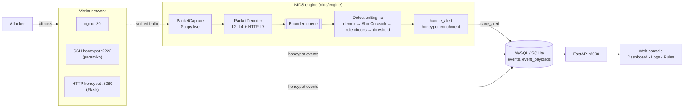

# Hybrid NIDS

**A real-time network intrusion detection system that combines Snort 3–compatible signature rules with SSH/HTTP honeypots, and comes with a shadcn-style web console.**


---

## Table of contents

- [Description](#description)
- [Project diagram](#project-diagram)
- [Features](#features)
- [Tech stack](#tech-stack)
- [Prerequisites](#prerequisites)
- [Installation](#installation)
- [Usage](#usage)
- [Docker](#docker)

---

## Description

Hybrid NIDS sniffs traffic live from a network interface. It decodes every packet from L2 up to HTTP (L7) and matches it against a set of Snort 3–syntax rules. Matching is fast because an Aho-Corasick prefilter scans each payload once, so only rules whose patterns actually appear get the full check.

Signatures only catch attacks that are already known. To cover more, the system runs SSH and HTTP honeypots that write into the same database. Nobody legitimate ever touches a honeypot, so any IP that does is a confirmed attacker. Rule alerts from those IPs are raised one priority level and tagged `[honeypot-confirmed]`.

All alerts and honeypot events end up in one database. A FastAPI service and a shadcn-style web console read from it, so you can watch alerts live, search the logs, inspect payloads and browse the loaded rules.

---

## Project diagram



The engine, the API and each honeypot run as **separate processes** and talk to each other only through the shared database. The API never calls the engine, so restarting the web console does not affect detection.

---

## Features

**Detection engine**
- Live packet capture in promiscuous mode with Scapy
- Packet decoding for IP/TCP/UDP/ICMP (including TCP flags) and HTTP request parsing (method, URI, headers, body)
- Snort 3 rule parser: sticky buffers (`http_uri`, `http_header`, `http_client_body`, `http_method`), comma modifiers (`nocase`, `depth`, `offset`, `distance`, `within`), `pcre`, `flags`, `flow`, `dsize`, `itype`/`icode`, `detection_filter`
- Four-stage matching funnel: protocol/port demux → Aho-Corasick prefilter (one matcher per buffer) → detailed option checks → `ThresholdManager` to stop alert storms
- 67 bundled rules split into one file per group (`rules/web-attack.rules`, `scan.rules`, `dos.rules`, `auth.rules`, `malware-c2.rules`, `recon.rules`), plus `rules/custom.rules` for rules written in the web console (SID ≥ 2000000):

  | SID range | Group | Examples |
  |---|---|---|
  | `10000xx` | WEB-ATTACK | SQLi, XSS, path traversal/LFI/RFI, command injection, Log4Shell, Shellshock, XXE, SSRF |
  | `10001xx` | SCAN | Nmap Xmas/Null/FIN, SYN-FIN, SYN-RST, port sweep, scanner user agents |
  | `10002xx` | DOS | SYN/UDP/ICMP/HTTP floods, Slowloris, large ICMP, NTP/DNS/Memcached amplification |
  | `10003xx` | AUTH | SSH/FTP/web brute force, anonymous FTP, HTTP Basic, admin login |
  | `10004xx` | MALWARE / C2 | Webshells, reverse shells, Mimikatz, EICAR, cryptominers, sqlmap, Nikto |
  | `10005xx` | RECON | SNMP `public`, DNS tunneling/AXFR/`version.bind`, ICMP timestamp/mask, NetBIOS, SSDP |

**Honeypots**
- SSH honeypot: accepts any password, opens a fake shell and records login attempts and commands
- HTTP honeypot: a fake WordPress login page that records credentials and tags SQL injection attempts as P1
- Attacker input is only recorded, never executed. If a database write fails, the sensor keeps running.
- Alert enrichment: rule alerts from an IP that touched a honeypot in the last hour are raised one priority level

**Web console** (served by the API, no extra build step)
- **Dashboard**: alert totals by priority, a stacked "alerts over time" chart (15 min to 24 h), top attack types, top attacking IPs, and a live feed that refreshes every 2 s
- **Status › System Logs**: tabs per source (NIDS, SSH honeypot, HTTP honeypot), an advanced filter (IP, SID, priority, protocol, time range, keyword), a detail view with the raw payload, one-click filter by IP/SID, delete a single row or everything matching the filter, CSV export
- **Services › Rules** (modelled on Suricata's pfSense page): enable or disable whole rule files on the Categories tab, toggle single SIDs and press Apply (with Reset All / Reset Current / Disable All / Enable All), and edit `custom.rules` with per-line syntax errors. Changes are stored in `rules/state.yaml` and the running engine reloads them within a few seconds. Write actions need the `NIDS_API_KEY` environment variable on the API server; the browser asks for the key once.
- Attack data is always rendered as plain text, so payloads never run as HTML

**REST API**
- Alert listing with filters and pagination (`X-Total-Count` header), detail, delete, CSV export, statistics, timeline and attacker summary
- Read-only rule listing
- Interactive OpenAPI docs at `/docs`

---

## Tech stack

| Layer | Technology |
|---|---|
| Language | Python 3.10+ |
| Packet capture & decoding | Scapy |
| Pattern matching | pyahocorasick (Aho-Corasick), Python `re` (PCRE) |
| Rule format | Snort 3 syntax (supported subset) |
| Storage | SQLAlchemy 2.0, MySQL (PyMySQL) or SQLite |
| API | FastAPI, Uvicorn, Pydantic |
| Honeypots | Paramiko (SSH), Flask (HTTP), pydantic-settings |
| Web console | Plain HTML, CSS and JavaScript, with hand-written SVG charts (no frontend build) |
| Configuration | YAML (`config/settings.yaml`) and environment variables |
| Lab environment | Docker Compose, Kali Linux attacker, nginx victim |
| Testing | pytest, FastAPI TestClient |

---

## Prerequisites

- **Python 3.10 or newer** and `pip`
- **Packet capture driver**:
  - Windows: [Npcap](https://npcap.com/#download), installed with *"WinPcap API-compatible Mode"*
  - Linux: `libpcap`, e.g. `sudo apt install -y libpcap-dev`
- **Database**: nothing extra for SQLite. For MySQL you need MySQL 8 and an empty database:
  ```sql
  CREATE DATABASE nids_db CHARACTER SET utf8mb4 COLLATE utf8mb4_unicode_ci;
  ```
- **Docker Desktop / Docker Engine with Compose v2** (only for the [Docker](#docker) lab)
- Administrator / root privileges for live sniffing

---

## Installation

```bash
git clone https://github.com/74Teams/intrusion-detection-system.git
cd intrusion-detection-system
pip install -r requirements.txt
cp config/settings.example.yaml config/settings.yaml
```

Then create your local config (git-ignored) from the template and edit it (`copy` instead of `cp` on Windows). If `config/settings.yaml` is missing, the program falls back to `config/settings.example.yaml`. The template defaults target the Docker lab (live capture on `eth0`, MySQL at `172.28.0.10`). For a local run, point `interface` at your network card and switch to SQLite:

```yaml
system:
  log_level: "INFO"            # "DEBUG" for per-rule details

network:
  interface: ""                # empty = default interface
  bpf_filter: "ip and not port 3306 and not (host 172.28.0.30 and port 6379)"
  capture_mode: "live"

detection:
  rules_dir: "rules"
  queue_max_size: 10000

database:
  type: "sqlite"               # or "mysql"
  db_url: "sqlite:///nids_events.db"
  # MySQL settings (used when type: "mysql")
  host: "localhost"
  port: 3306
  user: "root"
  password: "your_password"
  name: "nids_db"

redis:
  host: ""                     # empty = real-time push off, the dashboard polls instead
  port: 6379
  password: ""
```

The `NIDS_DB_HOST`, `NIDS_DB_PORT`, `NIDS_DB_NAME`, `NIDS_DB_USER` and `NIDS_DB_PASSWORD` environment variables override the MySQL settings; `NIDS_REDIS_HOST`, `NIDS_REDIS_PORT` and `NIDS_REDIS_PASSWORD` do the same for Redis. Honeypots read `HONEYPY_*` variables (for example `HONEYPY_SSH_PORT`, `HONEYPY_HTTP_USERNAME`).

---

## Usage

### 1. Live sniffing

Set `interface` in `config/settings.yaml` if needed, then run from an elevated shell:

```bash
python -m nids.engine
```

Alerts are printed as colour-coded log lines (P1 red, P2 yellow, P3 blue). Set `NO_COLOR=1` to turn the colours off.

### 2. Web console and API

```bash
uvicorn nids.api.main:app --host 0.0.0.0 --port 8000
```

| Page | URL |
|---|---|
| Dashboard | http://localhost:8000/ |
| System Logs | http://localhost:8000/logs |
| Rules | http://localhost:8000/rules |
| OpenAPI docs | http://localhost:8000/docs |

Main endpoints:

| Method | Endpoint | Description |
|---|---|---|
| `GET` | `/api/alerts/` | List alerts. Filters: `source_type`, `protocol`, `src_ip`, `dst_ip`, `sid`, `severity`, `since`, `until`, `q`; paging: `limit`, `offset` |
| `GET` | `/api/alerts/{id}` | Alert detail with raw payload |
| `DELETE` | `/api/alerts/{id}` | Delete one alert |
| `DELETE` | `/api/alerts/` | Delete alerts matching the same filters (no filter = delete all) |
| `GET` | `/api/alerts/export.csv` | Export matching alerts as CSV |
| `GET` | `/api/alerts/stats` | Totals by priority and top attack types |
| `GET` | `/api/alerts/timeline` | Alert counts per time bucket, split into NIDS and honeypot |
| `GET` | `/api/alerts/attackers` | Per-IP honeypot events and NIDS alerts |
| `GET` | `/api/alerts/sessions/{session_id}` | Events of one honeypot session, oldest first |
| `WS` | `/api/alerts/ws` | Pushes the id of each new alert (via Redis); the browser then reloads over REST. Closes with code 1013 when Redis is off or down |
| `GET` | `/api/rules/` | Rules with category and enabled state. Filters: `category`, `enabled`, `q` |
| `GET`, `PUT` | `/api/rules/categories` | List rule files / save which ones are loaded |
| `POST` | `/api/rules/sids` | Enable/disable SIDs (`{"enable": [...], "disable": [...]}`) |
| `POST` | `/api/rules/sids/reset` | Drop SID overrides for one category or all |
| `POST` | `/api/rules/categories/{name}/all` | Enable All / Disable All in one file |
| `GET`, `PUT` | `/api/rules/custom` | Read / replace `custom.rules` (rejected with line numbers if invalid) |
| `GET` | `/health` | Health check |

### 3. Honeypots

```bash
python -m nids.honeypot ssh          # SSH honeypot on port 2222
python -m nids.honeypot http         # HTTP honeypot on port 8080
```

### 4. Adding or changing rules

Built-in rules live in one file per group under `rules/`, written in Snort 3 syntax:

```text
alert tcp any any -> any $HTTP_PORTS (msg:"WEB-ATTACK SQL Injection - UNION SELECT detected"; flow:to_server,established; http_uri; content:"union",nocase; content:"select",nocase,distance 0; service:http; classtype:web-application-attack; priority:1; sid:1000001; rev:2;)
```

Pick a free SID in the right group's range, add a positive and a negative test plus a demo attack in `lab/attacker/attack_demo.py`, The running engine reloads rule files and `rules/state.yaml` within a few seconds, no restart needed. The full authoring guide is in [`.claude/rules/snort-rules.md`](.claude/rules/snort-rules.md).

### 5. Running the tests

```bash
pytest
```

---

## Docker

`docker compose up --build` starts a self-contained lab on an isolated bridge network (`172.28.0.0/16`):

| Container | Role | Address |
|---|---|---|
| `mysql_db` | Shared database | `172.28.0.10` |
| `redis` | Pub/sub that tells the API about new alerts (optional, not published to the host) | `172.28.0.30` |
| `victim_app` | nginx target with several services | `172.28.0.50` |
| `nids_engine` | Detection engine, sniffing the victim's traffic | shares the victim's network namespace |
| `honeypot_ssh` / `honeypot_http` | Honeypots on ports 2222 / 8080 | share the victim's network namespace |
| `nids_api` | API and web console, published on `localhost:8000` | `172.28.0.20` |
| `attacker` | Kali Linux with nmap, hping3, hydra, sqlmap, nikto | `172.28.0.100` |

Create `.env` first and fill in the three passwords (compose refuses to start without them). `openssl rand -hex 24` generates a good value:

```bash
cp .env.example .env     # set MYSQL_ROOT_PASSWORD, NIDS_DB_PASSWORD and NIDS_REDIS_PASSWORD
docker compose up --build -d
docker logs -f nids_engine                                        # wait for "Đã nạp 67 rule"
```

Use hex-only values (no `$`, quotes or backticks). Both passwords only take effect when MySQL first creates its data directory: a lab that already has a database keeps its old passwords. Either run `ALTER USER` for `root@'localhost'`, `root@'%'` and `nids_app@'%'` inside the `nids_mysql` container (connect with the old password) and then `docker compose up -d`, or recreate the DB volume (data in `events` is lost).

Open http://localhost:8000/, then launch attacks from the attacker container:

```bash
docker exec -it nids_attacker python lab/attacker/attack_demo.py all          # every rule
docker exec -it nids_attacker python lab/attacker/attack_demo.py web          # or: scan | dos | auth | malware | recon | honeypot
docker exec -it nids_attacker bash                                        # manual tools, e.g. nmap -sX -p 80 172.28.0.50
```

Notes:
- `nids_api` runs on its own address, so the dashboard's own requests (fallback polling, WebSocket) are never sniffed by the engine.
- `network.bpf_filter` excludes port 3306. Without it, the engine would see its own MySQL `INSERT`s, which contain attack strings, and raise alerts on them in a loop. It also excludes the lab's Redis (`172.28.0.30:6379`) but not port 6379 in general, so attacks aimed at that port on the victim are still seen.
- New alerts reach the dashboard through Redis in well under a second. Redis is optional: if it is stopped, the engine and honeypots keep running and the dashboard falls back to polling every 2 seconds, then switches back by itself once Redis returns.
- To start a fresh run, use **Xoá dữ liệu** on the dashboard or `curl -X DELETE http://localhost:8000/api/alerts/`.
- To stop the lab, run `docker compose down`. Add `-v` to also drop the MySQL data.
