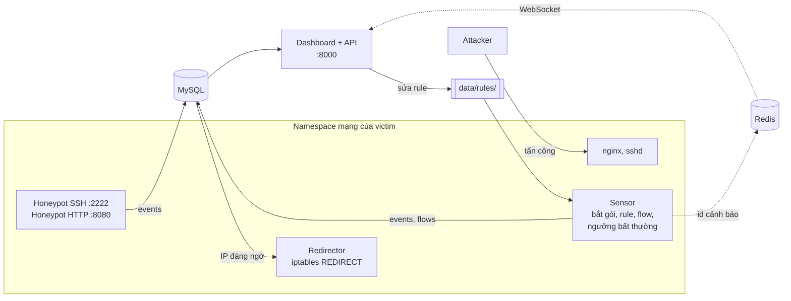

# Hybrid NIDS

Hệ thống phát hiện xâm nhập mạng thời gian thực (đồ án PBL4), kết hợp ba lớp phát hiện:

- **rule** cú pháp Snort 3, bắt tấn công có nội dung đặc trưng;
- **ngưỡng bất thường** theo cửa sổ thời gian, bắt quét cổng và flood chưa có rule;
- **mô hình học máy** theo flow (Random Forest), bắt hành vi như quét cổng, DoS, botnet.

Kèm theo là honeypot SSH/HTTP để xác nhận kẻ tấn công, bộ chuyển hướng IP đáng ngờ sang honeypot, web console xem cảnh báo và quản lý rule, và một Docker lab (attacker, victim) để trình diễn.


## Mục lục

- [Kiến trúc](#kiến-trúc)
- [Cấu trúc thư mục](#cấu-trúc-thư-mục)
- [Chạy nhanh bằng Docker](#chạy-nhanh-bằng-docker)
- [Chạy trực tiếp trên máy](#chạy-trực-tiếp-trên-máy)
- [Tài liệu](#tài-liệu)

## Kiến trúc

Các service chạy độc lập và chỉ giao tiếp qua cơ sở dữ liệu chung cùng các file rule. Ngoại lệ duy nhất là tín hiệu "có cảnh báo mới" qua Redis (chỉ chứa id); Redis tắt thì dashboard tự poll.



| Service | Thư mục | Vai trò |
|---|---|---|
| Sensor | `services/sensor/` | Bắt gói, so khớp rule, tái hợp TCP, gom flow, phát hiện bất thường, mô hình AI |
| Honeypot | `services/honeypot/` | Bẫy SSH (shell giả) và HTTP (trang đăng nhập WordPress giả); chỉ ghi lại, không bao giờ thực thi |
| Redirector | `services/redirector/` | Chuyển kết nối mới của IP đáng ngờ sang honeypot |
| Dashboard | `services/dashboard/` | REST API, WebSocket và trang web: Dashboard, Logs, Traffic, Rules |

## Cấu trúc thư mục

```
services/                      mỗi service: src/, tests/, Dockerfile, requirements.txt, README.md
├── sensor/  honeypot/  redirector/  dashboard/
common/
├── core/                      cấu hình, log, CSDL, kênh realtime dùng chung
├── config/                    settings.example.yaml (settings.yaml là file local)
└── tools/                     huấn luyện AI, bộ đo CIC-IDS2017, chuyển đổi rule
data/
├── rules/                     rule Snort 3 theo category (68 rule tự viết + ~2.800 rule community)
├── models/                    mô hình Random Forest
├── pcap/                      pcap nhỏ cho test và demo
└── work/                      dữ liệu sinh ra khi làm việc (không commit)
lab/                           attacker (Kali) và victim (nginx, sshd, vsftpd)
docs/  tests/  scripts/
docker-compose.yml  requirements-dev.txt  .env.example
```

Mã nguồn dùng chung họ tên module `nids.*`: mỗi thư mục `src/` đóng góp một phần (`nids.engine` ở sensor, `nids.honeypot` ở honeypot, `nids.db` ở `common/core`...).

## Chạy nhanh bằng Docker

Cần Docker Engine hoặc Docker Desktop với Compose v2.

```bash
cp .env.example .env     # điền MYSQL_ROOT_PASSWORD, NIDS_DB_PASSWORD, NIDS_REDIS_PASSWORD (chuỗi hex, ví dụ: openssl rand -hex 24)
docker compose up --build -d
docker logs -f nids_engine                     # chờ dòng "Đã nạp ... rule"
```

Mở http://localhost:8000/ (Swagger ở `/docs`). Muốn demo tấn công thì bật thêm máy attacker:

```bash
docker compose --profile lab up --build -d
docker exec -it nids_attacker python lab/attacker/attack_demo.py all       # mọi rule
docker exec -it nids_attacker bash                                         # tự gõ lệnh: nmap, hping3, hydra, sqlmap...
```

Dừng: `docker compose down` (thêm `-v` nếu muốn xoá dữ liệu MySQL).

## Chạy trực tiếp trên máy

Cần Python 3.10+, driver bắt gói (Npcap trên Windows, `libpcap-dev` trên Linux) và quyền admin/root khi sniff live.

```powershell
pip install -r requirements-dev.txt
copy common\config\settings.example.yaml common\config\settings.yaml     # rồi chuyển database sang sqlite, tắt redis và redirect
. .\scripts\env.ps1                    # bash: source scripts/env.sh. Đặt PYTHONPATH, mỗi terminal một lần

python -m nids.engine                                          # sensor (live hoặc offline theo settings.yaml)
uvicorn nids.api.main:app --host 0.0.0.0 --port 8000           # dashboard
python -m nids.honeypot ssh                                    # honeypot (tuỳ chọn)
pytest                                                         # toàn bộ test
```

Hướng dẫn chi tiết, cấu hình và lỗi thường gặp: [docs/quick-start-guide.md](docs/quick-start-guide.md).

## Tài liệu

Toàn bộ tài liệu (tiếng Việt) nằm trong [`docs/`](docs/README.md):

| Tài liệu | Nội dung |
|---|---|
| [quick-start-guide.md](docs/quick-start-guide.md) | Cài đặt, Docker lab, chạy trực tiếp, lỗi thường gặp |
| [system-architecture.md](docs/system-architecture.md) | Process, luồng dữ liệu, CSDL, Redis, mạng Docker |
| [technology-stack.md](docs/technology-stack.md) | Công nghệ từng tầng và lý do chọn |
| [detection-engine.md](docs/detection-engine.md) | Pipeline, rule Snort 3, phễu so khớp, tái hợp TCP, flow, ngưỡng bất thường |
| [honeypot-and-redirect.md](docs/honeypot-and-redirect.md) | Honeypot, làm giàu cảnh báo, chuyển hướng bằng iptables |
| [machine-learning-guide.md](docs/machine-learning-guide.md) | Mô hình AI theo flow: đặc trưng, dữ liệu, huấn luyện, kết quả |
| [performance-metrics.md](docs/performance-metrics.md) | Đánh giá trên CIC-IDS2017 |
| [api-reference.md](docs/api-reference.md) | REST API và WebSocket |
| [demo-flow-explanation.md](docs/demo-flow-explanation.md) | Kịch bản demo và bảng lệnh tấn công thủ công |

Quy ước làm việc cho Claude Code: [CLAUDE.md](CLAUDE.md) và `.claude/rules/`.
