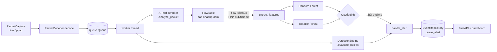

# 3. Kiến trúc

## 3.1 Luồng dữ liệu



Phần capture, decoder, queue, `handle_alert`, `EventRepository` và API **giữ nguyên**. Mọi thay đổi chỉ nằm phía sau lời gọi `ai_worker.analyze_packet(packet)` trong `nids/engine/main.py`.

## 3.2 Module dự kiến

`nids/ai.py` sẽ chuyển thành package `nids/ai/`. Package export lại `AITrafficWorker` trong `__init__.py` để dòng `from nids.ai import AITrafficWorker` trong `nids/engine/main.py` vẫn chạy được mà không phải sửa.

```
nids/ai/
├── __init__.py      # from nids.ai.worker import AITrafficWorker
├── flow.py          # FlowKey, Flow, FlowTable
├── features.py      # FEATURE_NAMES, extract_features(flow)
├── model.py         # nạp và gọi mô hình
└── worker.py        # AITrafficWorker
tools/ai/
├── build_dataset.py # pcap / CSV → bảng đặc trưng (parquet/CSV)
└── train.py         # huấn luyện, đánh giá, xuất mô hình + báo cáo
models/              # file mô hình .joblib (không commit file lớn)
```

### `flow.py`

- `FlowKey`: 5-tuple đã chuẩn hoá hai chiều (sắp xếp hai đầu mút `(ip, port)`) cộng với protocol. Mỗi flow ghi nhớ bên khởi tạo để phân biệt chiều fwd và bwd.
- `Flow`: chỉ lưu **bộ đếm tăng dần**, không lưu gói: `first_ts`, `last_ts`, count/sum/sum²/min/max của độ dài payload và IAT theo từng chiều, cộng số lần xuất hiện mỗi cờ TCP. Phương thức `update(packet)` có độ phức tạp O(1).
- `FlowTable`:
  - `add(packet) -> Optional[Flow]`: cập nhật flow; trả về flow nếu gói vừa đóng flow (FIN ở cả hai chiều hoặc RST).
  - `expire(now) -> list[Flow]`: lấy ra các flow vượt idle timeout hoặc active timeout. `now` là `packet.timestamp`, nhờ vậy chế độ offline pcap cho kết quả lặp lại được.
  - Giới hạn số flow tối đa (`max_flows`). Khi đầy thì đóng sớm flow cũ nhất, để một trận flood hàng nghìn flow không làm tràn RAM.

### `features.py`

- `FEATURE_NAMES: list[str]`: thứ tự cột cố định, được lưu kèm mô hình.
- `extract_features(flow) -> dict[str, float]`: tính các đặc trưng ở mục 2.3 từ bộ đếm của flow. Đây là **hàm duy nhất** mà cả `tools/ai/build_dataset.py` lẫn worker cùng gọi, để train và chạy thật không bao giờ lệch đặc trưng.

### `model.py`

- Nạp một file `joblib` chứa `{"rf": ..., "iforest": ..., "feature_names": [...], "labels": [...], "thresholds": {...}, "version": "..."}`.
- Lúc nạp, kiểm tra `feature_names` khớp với `FEATURE_NAMES`. Không khớp thì log lỗi và tắt AI, **không làm sập engine**.
- `predict(features) -> (label, rf_proba, anomaly_score)`.

### `worker.py`: `AITrafficWorker`

```python
class AITrafficWorker:
    def __init__(self, alert_callback=None): ...       # giữ nguyên chữ ký hiện tại
    def analyze_packet(self, packet: DecodedPacket) -> None:
        # 1. flow = table.add(packet); nếu flow vừa đóng thì đánh giá
        # 2. định kỳ (theo packet.timestamp) gọi table.expire() rồi đánh giá các flow hết hạn
    def flush(self) -> None:
        # đánh giá mọi flow còn mở; gọi khi kết thúc đọc pcap offline
```

- Không có file mô hình, hoặc `detection.enable_ai_worker: false`: worker vẫn chạy nhưng không làm gì (giống stub hiện tại) và chỉ ghi một dòng log cảnh báo lúc khởi động.
- Logger: `logging.getLogger("nids.ai")`, thêm khu vực `ai` vào danh sách trong `CLAUDE.md`.

## 3.3 Logic quyết định

```
label, p, s = model.predict(features)

nếu label != "BENIGN" và p >= rf_threshold:
    cảnh báo P2, classtype = label                    # tấn công đã biết
ngược lại nếu s >= if_threshold:
    cảnh báo P3, classtype = "ai-anomaly"             # bất thường chưa có nhãn
ngược lại:
    bỏ qua
```

- RF có độ tin cậy cao hơn nên được P2. IsolationForest dễ báo nhầm nên chỉ được P3.
- Để tránh bão cảnh báo, một cặp `(src_ip, label)` chỉ sinh **một cảnh báo trong mỗi cửa sổ thời gian** (ví dụ 60 giây). Một trận port scan tạo hàng nghìn flow nhưng chỉ cần một dòng cảnh báo, kèm số flow bị gộp. Cơ chế này giống ý tưởng của `ThresholdManager`; có thể dùng lại `ThresholdManager` nếu giao diện phù hợp, nếu không thì viết một dict nhỏ trong worker.
- Flow có quá ít gói (ví dụ ≤ 2 gói, trừ flow chỉ có SYN) sẽ được bỏ qua với IsolationForest để giảm báo nhầm, nhưng vẫn đi qua RF vì đó chính là dấu hiệu của port scan.

## 3.4 Hợp đồng `alert_data`

Cảnh báo AI dùng **đúng tập key** mà `DetectionEngine` đang gửi (`nids/engine/detector.py`), nhờ vậy `handle_alert`, `format_alert` và `EventRepository.save_alert` dùng được ngay:

| Key | Giá trị cho AI |
|-----|----------------|
| `timestamp` | `flow.last_ts` |
| `sid` | `None`. `format_alert` đã hiển thị nhãn `AI-ANOMALY` khi `sid` là `None` |
| `msg` | ví dụ `"AI: PortScan (p=0.97, 312 flow)"` hoặc `"AI: lưu lượng bất thường (score=0.71)"` |
| `severity` | 2 (RF) hoặc 3 (IsolationForest) |
| `classtype` | nhãn RF (`PortScan`, `DoS`, `BruteForce`, `WebAttack`) hoặc `ai-anomaly`; được lưu vào cột `attack_type` |
| `source_type` | `"AI_ENGINE"`. Cột `events.source_type` đã có, API lọc được bằng `?source_type=AI_ENGINE` |
| `src_ip`, `src_port`, `dst_ip`, `dst_port`, `protocol` | lấy từ bên khởi tạo flow |
| `http_uri`, `http_method` | `None` |
| `suppressed_hits` | số flow bị gộp vào cảnh báo này |

Ghi chú:

- `enrich_alert` hiện chỉ nâng priority cho cảnh báo có `source_type="RULE_ENGINE"`. Có cho cảnh báo AI từ IP đã chạm honeypot được nâng priority hay không là quyết định ở giai đoạn 3. Nếu làm thì chỉ cần sửa một điều kiện.
- Biểu đồ dashboard hiện chia cột thành "honeypot" và "còn lại", nên cảnh báo AI tạm thời được tính vào phần NIDS. Tách thành màu riêng là việc tuỳ chọn.

## 3.5 Cấu hình

Thêm mục `ai` vào `config/settings.yaml`. Key `detection.enable_ai_worker` đã có sẵn và được dùng làm công tắc chính.

```yaml
ai:
  model_path: "models/flow_model.joblib"
  idle_timeout: 30        # giây
  active_timeout: 120     # giây
  max_flows: 100000
  rf_threshold: 0.8       # chọn lại sau khi đánh giá
  if_threshold: 0.65      # chọn lại sau khi đánh giá
  alert_window: 60        # giây, gộp cảnh báo theo (src_ip, label)
```

## 3.6 Hiệu năng

| Thao tác | Tần suất | Chi phí |
|----------|----------|---------|
| `FlowTable.add` | mỗi gói | O(1): một lần tra dict và vài phép cộng |
| `FlowTable.expire` | mỗi N giây theo `packet.timestamp` | O(số flow đang mở) |
| `extract_features` + `predict` | mỗi flow kết thúc | khoảng 0.1–1 ms cho mỗi flow với RF 100 cây; gom nhiều flow để predict theo lô khi `expire` trả về nhiều flow |

Rule engine đã xử lý từng gói rồi, nên phần việc AI thêm vào cho mỗi gói là rất nhỏ. Rủi ro hiệu năng nằm ở lúc flood: rất nhiều flow kết thúc cùng lúc. Có ba cách giảm: predict theo lô, gộp cảnh báo, và đặt `n_estimators` vừa phải (100 cây, `max_depth` khoảng 20). Tiêu chí nghiệm thu về throughput nằm ở [05-lo-trinh-va-ket-qua.md](05-lo-trinh-va-ket-qua.md).
