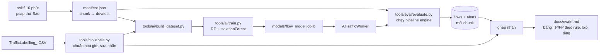

# PLAN-009: Bộ đo có nhãn CIC-IDS2017 và tối ưu toàn hệ thống trong 3 tuần

## 1. Bối cảnh

Ngày 10/11/2026 nhóm đo engine trên `pcap/chienbuoito.pcap`, đoạn 10 phút (14:09–14:19 giờ ADT) của CIC-IDS2017 ngày thứ Sáu. Chi tiết ở `docs/danh-gia-bo-rule.md`. Có ba vấn đề:

1. **Rớt gói:** với `queue_max_size` mặc định 10.000, engine bỏ 91.836/106.955 gói (86%). Nguyên nhân là mỗi cảnh báo được ghi CSDL đồng bộ ngay trong worker thread (khoảng 11 ms một cảnh báo với SQLite). Khi không ghi CSDL, worker xử lý khoảng 18.700 gói/giây, còn phía đọc và decode bằng Scapy chỉ đạt khoảng 4.400 gói/giây.
2. **Báo nhầm và bỏ sót:** ghép flow của engine với file nhãn `TrafficLabelling_` của CIC thì khớp 99,2% số flow (7.637/7.697). Theo nhãn đó, rule chỉ bắt 13/118 flow PortScan (11%), nhưng bắn trên 3.698/7.519 flow BENIGN (49%). Bốn rule 1000205, 1000107, 1000209, 1000038 gây gần hết số báo nhầm. Botnet Ares gọi về `205.174.165.73:8080` mà không có cảnh báo nào.
3. **AI vẫn là stub:** `nids/ai.py` chưa làm gì. Issue #22 và #23 đã đóng (NOT_PLANNED) để chờ flow log (#39) và lớp ngưỡng (#42); cả hai đã merge.

Dữ liệu hiện có trên máy nldd0507:

| Dữ liệu | Vị trí | Nội dung |
| :--- | :--- | :--- |
| Pcap thứ Sáu | `D:\Tools\PBL4\Friday-WorkingHours.pcap` | 9.997.874 gói, 8,8 GB, 08:59–17:02 giờ ADT |
| Pcap thứ Sáu đã cắt | `D:\Tools\PBL4\split\` | 58 file, 16 GB: **hai bộ cắt chồng nhau** (theo 10 phút và theo 1 triệu gói), tổng 19 triệu gói |
| CSV có IP, cổng, giờ | `D:\Temp\Temp\TrafficLabelling_\` | 8 file, 2,8 triệu flow do CICFlowMeter sinh, có cột `Label` |
| CSV chỉ có đặc trưng | `D:\Temp\Temp\MachineLearningCVE\` | 78 đặc trưng + `Label`, không có IP, cổng, giờ |

Người dùng muốn dùng các file này để đo và tối ưu đầu ra của cả hệ thống trong 3 tuần (11/11 đến 01/12/2026), với 2 người làm.

## 2. Mục tiêu và tiêu chí thành công

- **Mục tiêu:** có một bộ đo có nhãn chạy lại được bằng một lệnh. Dùng nó để tối ưu hiệu năng engine, độ chính xác của rule và lớp ANOMALY, và đưa AI worker vào chạy thật. Mọi thay đổi đều được chứng minh bằng số liệu trước và sau.
- **Xong khi** (đo trên tập *test* của thứ Sáu, mục 6.3; mọi số liệu nằm trong `docs/eval/`):

Tiêu chí 3–7 đo trên tập test bằng `tools/eval/evaluate.py`. Tiêu chí 1, 2 và 8 là số đo hiệu năng, đo bằng `python -m nids.engine` thật (có queue, có ghi CSDL), offline, SQLite, `queue_max_size: 10000`, trên hai chunk dev: `pcap/chienbuoito.pcap` (chunk 14:09) và chunk có nhiều gói nhất theo `manifest.md` (theo `docs/eval/manifest.md` là `09:19`, 1.920.415 gói).

| # | Tiêu chí | Hiện tại | Ngưỡng |
| :- | :--- | :--- | :--- |
| 1 | Gói bị bỏ do queue đầy (engine thật, offline) | 86% | 0 |
| 2 | Thông lượng offline end-to-end, có ghi CSDL SQLite (dòng tổng kết của engine) | 1.680 gói/giây | ≥ 3.000 gói/giây |
| 3 | Tỉ lệ flow BENIGN bị rule báo | 52,3% (baseline dev; đoạn 14:09 là 49%) | ≤ 2% |
| 4 | Độ chính xác cảnh báo rule (cảnh báo rơi vào flow tấn công / tổng cảnh báo) | 30,3% (baseline dev; đoạn 14:09 là 0,1%) | ≥ 80% |
| 5 | Phát hiện theo đợt (rule hoặc ANOMALY hoặc AI), định nghĩa đợt ở 6.3 | dev: 4/5 đợt PortScan, 1/1 DDoS, 3/3 máy Bot (baseline) | 100% số đợt PortScan, DDoS và máy nhiễm Bot trong tập test |
| 6 | AI: macro F1 trên tập test (BENIGN, PortScan, DDoS, Bot) | không có | ≥ 0,90; FPR ≤ 1% |
| 7 | AI bắt được flow tấn công mà rule và ANOMALY bỏ sót | không có | ≥ 1 loại (dự kiến Bot) |
| 8 | Bật AI (engine thật): thời gian xử lý tăng, gói bị bỏ | không có | tăng ≤ 20%, vẫn 0 gói bị bỏ |
| 9 | Tái lập | không có | chạy lại `evaluate.py` và `train.py` trên hai máy khác `settings.yaml` vẫn ra cùng số liệu |

Ngưỡng 6 thấp hơn mức 0,95 của `docs/ai/05-lo-trinh-va-ket-qua.md`, vì chia theo thời gian khó hơn chia ngẫu nhiên (mục 6.4). Báo cáo ghi cả hai cách chia.

## 3. Phạm vi

- **Trong phạm vi:**
  - Module nhãn CIC-IDS2017 dùng chung: đọc CSV, chuẩn hoá giờ, ghép nhãn vào flow, sửa các nhãn sai đã biết.
  - Bộ đo engine (`tools/eval/`): phễu gói, thời gian từng bước, độ chính xác và độ phủ theo rule, theo lớp, theo tầng phát hiện.
  - Tối ưu engine: offline không rớt gói, ghi cảnh báo theo lô ở thread riêng, sửa khoá `ThresholdManager`, lọc tầng Scapy, quét timeout flow hiệu quả hơn.
  - Tối ưu phát hiện: sửa 4 rule báo nhầm, thêm rule cho tấn công thứ Sáu, chỉnh ngưỡng ANOMALY bằng dữ liệu.
  - AI: bổ sung bộ đếm cho `Flow`, `FEATURE_NAMES`/`extract_features`, dựng dataset từ pcap thứ Sáu, huấn luyện RF + IsolationForest, tích hợp `AITrafficWorker`.
  - Mô hình nền tham khảo trên `MachineLearningCVE` (cả 8 file) để so với các bài báo.
- **Mở rộng sau 3 tuần (đã chốt hướng, chưa tính vào tiêu chí):** người dùng sẽ tải đủ pcap CIC-IDS2017 (thứ Hai đến thứ Năm). Mọi công cụ nhận ngày làm tham số: thêm một ngày chỉ cần cắt pcap 10 phút, chạy `manifest.py` và `evaluate.py` cho ngày đó, rồi train lại. Các ngày này mở thêm các lớp `DoS`, `BruteForce`, `WebAttack` (rule web của dự án được đo lần đầu trên traffic thật).
- **Ngoài phạm vi:**
  - Chạy đánh giá trên các ngày thứ Hai đến thứ Năm trong 3 tuần này (chưa có pcap).
  - Decoder viết lại bằng `struct` thay Scapy. Chỉ đo thử nguyên mẫu ở tuần 3 nếu còn thời gian; quyết định thay thế là plan riêng.
  - Cài option Snort mới (`flowbits`, `byte_test`...) để bật `community.rules`.
  - Dashboard mới cho số liệu đánh giá (báo cáo ở dạng Markdown).
  - Lab VMware (#68, PLAN-008) và honeypot.

## 4. Hiện trạng

**Engine (`nids/engine/main.py`)**

- `on_raw_packet` (dòng 284) decode trong thread bắt gói rồi gọi `packet_queue.put_nowait` (dòng 290). Queue đầy thì bỏ gói, kể cả ở chế độ offline, trong khi offline không có lý do phải vội.
- `handle_alert` (dòng 232–242) in log rồi gọi `EventRepository.save_alert` (`nids/db/repository.py:19`). Hàm này mở session, `commit`, `refresh` rồi `publish_alert` cho từng cảnh báo, tất cả trong worker thread.
- `FlowLog` (dòng 106–172) đã ghi flow theo lô qua `EventRepository.save_flows` (`repository.py:249`). Dùng lại được làm mẫu cho bộ ghi cảnh báo theo lô.
- Worker gọi `ai_worker.analyze_packet` (dòng 314). `AITrafficWorker` (`nids/ai.py`) là stub.

**Threshold (`nids/engine/threshold.py:34`)**

- Khoá chặn là `(sid, src_ip, dst_ip, dst_port)` và thời gian lấy từ `time.time()`.
- Với rule `track by_dst` như 1000205, gói DNS trả lời có cổng đích ngẫu nhiên, nên mỗi gói là một khoá mới và không bị chặn: rule bắn 2.145 lần trong 10 phút.
- Dùng giờ hệ thống nên replay pcap nhanh hơn thời gian thật cho kết quả khác chạy live, và không lặp lại được.
- `DetectionEngine` gọi `should_alert` ở `detector.py:357`.
- `AnomalyDetector` cũng dùng một `ThresholdManager` riêng (`anomaly.py:59`, gọi ở `anomaly.py:137`), với cùng vấn đề giờ hệ thống. Trong code đã có ghi chú "shortcut" ở dòng 58.
- `_last_cleanup` khởi tạo bằng `time.time()` (`threshold.py:14`), nên khi đổi sang giờ của gói 2017 thì cache không bao giờ được dọn.

**Biến header rule**

- `RuleManager(variables=...)` **thay hẳn** bộ biến (`rule_manager.py:46`). Chỉ `get_rule_variables()` (`config.py:56`) mới gộp `DEFAULT_RULE_VARIABLES` với `settings.yaml`.
- `decoder.HTTP_PORTS` được tính một lần lúc import, từ `settings.yaml` (`decoder.py:13`).
- 35 rule built-in dùng `$HTTP_PORTS`, gồm 1000209 và 1000038.

**Flow (`nids/engine/flow.py`)**

- `Flow` mới có số gói, số byte và cờ TCP. Chưa có thống kê độ dài gói, IAT (khoảng thời gian giữa hai gói), payload, nên chưa đủ đặc trưng cho AI.
- `FlowTracker.expire` (dòng 119) duyệt toàn bảng mỗi giây theo giờ gói, tức O(số flow). Bảng 100.000 flow khi bị flood sẽ tốn đáng kể.

**Decoder**

- Scapy bóc mọi tầng (DNS, TLS...) dù decoder chỉ dùng tới L4.
- Đo thử `conf.layers.filter` trên 40.000 gói: tăng từ 3.432 lên 3.954 gói/giây (+15%), kết quả decode giống hệt (cùng hash).

**Hỗ trợ có sẵn để dùng lại**

- `RuleManager(rules_dir, variables=...)` và `DEFAULT_RULE_VARIABLES`: bộ đo dựng bộ biến đầy đủ (mục 6.4) mà không sửa `settings.yaml`.
- Công tắc AI đã có: `detection.enable_ai_worker` (`config/settings.example.yaml:19`).
- `DetectionEngine(..., enable_threshold=...)`, `StreamReassembler`, `AnomalyDetector`, `evaluate_with_stream` (`main.py:175`): bộ đo gọi đúng pipeline của engine.
- `format_summary`, `DropCounter` (`main.py:48`, `55`).

**Dữ liệu CIC: những điểm cần xử lý**

- Cột `Timestamp` dạng `d/m/yyyy h:mm`: 12 giờ, **không có AM/PM**, chỉ tới phút (riêng thứ Hai có giây). Giờ là giờ ADT (UTC−3). Ví dụ `2:09` trong file buổi chiều là 14:09 ADT, tức 17:09 UTC.
- Tên cột có khoảng trắng đầu; có cột `Fwd Header Length` lặp; có giá trị `inf`/`NaN` (`Flow Bytes/s`); file WebAttacks có ký tự lỗi mã hoá (`Web Attack � Brute Force`), phải đọc bằng `latin-1`.
- Nhãn sai đã biết (Engelen và cộng sự, 2021): ví dụ flow giữa các máy nhiễm và máy điều khiển `205.174.165.73` ngoài khung giờ Bot lại mang nhãn BENIGN. Trong đoạn 14:09–14:19, 42 flow tới IP này đều là BENIGN.
- Các đợt tấn công thứ Sáu theo nhãn CSV (giờ ADT): Bot 10:04–12:59; PortScan 13:05–13:06, 13:52–14:00, 14:14–14:16, 14:51–14:56, 15:03–15:13, 15:21–15:23; DDoS 15:56–16:16. Kẻ tấn công: `172.16.0.1` (PortScan, DDoS), máy điều khiển `205.174.165.73` (Bot).

## 5. Các phương án đã cân nhắc

**5.1 Nguồn nhãn cho flow của engine**

| Phương án | Ưu điểm | Nhược điểm | Kết luận |
| :--- | :--- | :--- | :--- |
| A. Ghép với CSV `TrafficLabelling_` theo 5-tuple + giờ (±2 phút) | Đã thử: khớp 99,2%; nhãn chi tiết tới từng flow | Kế thừa nhãn sai của CIC | **Chọn**, kèm bảng sửa nhãn (mục 6.2) |
| B. Chỉ gán theo IP kẻ tấn công + khung giờ (cách ghi trong `docs/ai/04`) | Đơn giản, tránh nhãn sai | Gán nhầm traffic BENIGN của `172.16.0.1` (23/161 flow trong đoạn thử) | Loại làm nguồn chính; dùng làm bảng sửa nhãn |

**5.2 Dữ liệu huấn luyện AI**

| Phương án | Ưu điểm | Nhược điểm | Kết luận |
| :--- | :--- | :--- | :--- |
| A. Tự trích đặc trưng từ pcap thứ Sáu bằng extractor của engine, nhãn từ 5.1 | Train và chạy thật dùng cùng một hàm, không lệch đặc trưng | Chỉ có 3 lớp tấn công của thứ Sáu; trích 10 triệu gói mất thời gian | **Chọn** làm mô hình chạy thật |
| B. Train thẳng trên `MachineLearningCVE` | Đủ mọi loại tấn công, không cần pcap | Đặc trưng CICFlowMeter (Java) khác extractor Python; mô hình dễ hỏng khi chạy trong engine | Chỉ dùng làm mô hình nền để so sánh, không đưa vào engine |

**5.3 Ghi cảnh báo vào CSDL**

| Phương án | Ưu điểm | Nhược điểm | Kết luận |
| :--- | :--- | :--- | :--- |
| A. Thread ghi riêng, queue có giới hạn, ghi theo lô (một `commit` cho tối đa N cảnh báo hoặc mỗi T giây) | Worker không chờ CSDL; giữ nguyên quy tắc "lỗi CSDL không làm sập sensor" | Thêm một thread; khi dừng phải ghi nốt | **Chọn** |
| B. Giữ ghi đồng bộ, chỉ bật SQLite WAL + `synchronous=NORMAL` | Sửa ít | MySQL trong Docker không đổi gì; vẫn một `commit` cho mỗi cảnh báo | Loại làm giải pháp chính; WAL vẫn bật thêm cho SQLite |

**5.4 Chia tập train và test**

| Phương án | Ưu điểm | Nhược điểm | Kết luận |
| :--- | :--- | :--- | :--- |
| A. Ngẫu nhiên phân tầng 60/20/20 (theo `docs/ai/04`) | So được với bài báo | Flow cùng một đợt tấn công nằm ở cả train lẫn test, nên điểm bị thổi phồng | Chỉ báo cáo để tham khảo |
| B. Theo thời gian: các chunk 10 phút của đợt sau làm test | Sát thực tế: mô hình gặp đợt tấn công chưa thấy | Điểm thấp hơn; DDoS chỉ có một đợt nên phải cắt đôi | **Chọn** làm số liệu chính; cùng một tập test cho rule, ANOMALY và AI |

**5.5 Tăng tốc phía decode**

| Phương án | Ưu điểm | Nhược điểm | Kết luận |
| :--- | :--- | :--- | :--- |
| A. `conf.layers.filter` chỉ giữ Ether/IP/IPv6/TCP/UDP/ICMP/Raw | Đã đo: +15%, kết quả không đổi | Lợi ít | **Chọn** (tuần 1) |
| B. Decoder thô bằng `struct` | Ước tính nhanh hơn nhiều lần (đọc thô 108.000 gói chỉ mất 0,6 s) | Viết lại decoder, dễ lệch hành vi | Chỉ đo nguyên mẫu ở tuần 3; thay hẳn là plan sau |
| C. Chạy song song theo chunk khi dựng dataset và chạy bộ đo | 16 nhân CPU, mỗi chunk độc lập | Flow cắt ngang ranh giới chunk bị tách đôi | **Chọn** cho công cụ trong `tools/`, không dùng trong engine |

## 6. Thiết kế đã chọn

### 6.1 Luồng tổng thể

### 6.2 Module nhãn `tools/cic/labels.py`

- `load_labels(csv_paths) -> DataFrame`: đọc `latin-1`, bỏ khoảng trắng tên cột, bỏ dòng rỗng, đổi `Timestamp` 12 giờ sang UTC. Giờ 1–7 là buổi chiều, trừ file thứ Hai có giây. Khoá là `(protocol, (ip, port) nhỏ hơn, (ip, port) lớn hơn)`, đúng định nghĩa của `flow_key` (`nids/engine/flow.py`).
- `label_flows(flows, labels, tolerance_s=120)`: với mỗi flow của engine, tìm dòng CSV cùng khoá có giờ trong `[first_seen − 120 s, last_seen + 120 s]`. Có dòng tấn công thì lấy nhãn tấn công, không thì BENIGN, không có dòng nào thì `UNLABELED`. Flow `UNLABELED` bị loại khỏi phép tính và được đếm riêng trong báo cáo.
- Bảng sửa nhãn `CORRECTIONS` viết trong code, ghi nguồn:
  - Mọi flow có IP `205.174.165.73` là `Bot`. Các máy nhiễm gọi về IP này cả ngoài khung giờ Bot của CSV, nên sau khi sửa nhãn, flow Bot có mặt trong gần như mọi chunk. `manifest.py` phải in số flow Bot đã sửa theo từng chunk để xác nhận.
  - Lớp gộp: `DDoS`, `PortScan`, `Bot`, `BENIGN`.
- Báo cáo luôn in hai cột, nhãn gốc và nhãn đã sửa, để giảng viên thấy tác động của việc sửa.

### 6.3 Chọn chunk và chia dev/test

- `tools/cic/manifest.py` quét `split/`, chỉ lấy **bộ 10 phút** (49 file). Bộ này bắt đầu lúc 08:59:39 ADT, nên mọi chunk bắt đầu ở phút :x9 (08:59, 09:09... 16:59; đoạn `chienbuoito.pcap` chính là chunk 14:09). Công cụ kiểm tra tổng số gói bằng file gốc (9.997.874); sai thì dừng.
- Manifest sinh **tất định** từ code: cùng thư mục cho cùng kết quả. Công cụ ghi `data/cic/friday_manifest.json` (gitignore) và một bản tóm tắt được commit, `docs/eval/manifest.md` (danh sách chunk, tập, số flow theo nhãn), để 2 người dùng cùng một cách chia.
- **Tập test** gồm các chunk có giờ bắt đầu (ADT):
  - PortScan: `14:59`, `15:09`, `15:19` (các đợt 15:03–15:13 và 15:21–15:23).
  - DDoS: `16:09` (khoảng 7 phút cuối của đợt 15:56–16:16; dev giữ chunk `15:49` và `15:59`, khoảng 13 phút).
  - Hai chunk không có PortScan hay DDoS: `09:09` và `16:29`. Theo nhãn đã sửa, các chunk này vẫn có flow Bot (mục 6.2), nên dùng để đo FPR trên BENIGN và đo Bot.
- **Bot chia theo máy nhiễm**, vì Bot có mặt cả ngày nên chia theo thời gian không tạo ra "đợt chưa thấy":
  - `manifest.py` liệt kê các máy nhiễm (IP nội bộ có flow tới `205.174.165.73`), rồi chọn tất định 2 máy có IP nhỏ nhất làm **máy test**.
  - Trong chunk **test**: flow Bot của máy *không phải* máy test bị loại khỏi mọi phép tính (đếm riêng là `EXCLUDED`, như `UNLABELED`). Mọi số liệu Bot, FPR, độ chính xác cảnh báo và macro F1 trên test chỉ tính phần còn lại.
  - Trong chunk **dev**: flow của máy test bị loại khỏi cả huấn luyện lẫn bảng số liệu dùng để chỉnh rule và ngưỡng (cũng là `EXCLUDED`).
  - Giới hạn cần ghi trong báo cáo: Bot trên test chỉ gồm beacon ngoài khung 10:04–12:59 (thường chỉ có SYN và RST). `manifest.md` in số flow Bot theo chunk và theo máy; chunk dùng ở mục 9 bước 7 phải có beacon của máy test (chọn chunk dự phòng theo bảng này).
- **Định nghĩa đợt** (tiêu chí 5):
  - PortScan và DDoS: mỗi khoảng phút liên tục trong CSV là một đợt (6 đợt PortScan, 1 đợt DDoS; mục 4).
  - Bot: mỗi máy nhiễm là một "đợt".
  - Đợt được phát hiện khi có ít nhất một cảnh báo trên flow của đợt nằm trong tập đang đo.
- Các chunk còn lại là **dev**: dùng để sửa rule, chỉnh ngưỡng và huấn luyện. **Không ai được nhìn số liệu test khi đang chỉnh**; chỉ chạy test ở mốc cuối tuần 2 và cuối tuần 3.

### 6.4 Bộ đo `tools/eval/evaluate.py`

- Đầu vào: manifest, tập (`dev`/`test`/danh sách chunk), `--set-var HOME_NET=192.168.10.0/24` (lặp được), `--rules-dir`, `--ai-model`, số tiến trình song song.
- **Bộ biến không phụ thuộc máy:**
  - Bộ đo dựng `variables = {**DEFAULT_RULE_VARIABLES, **override}`, **không** đọc `detection.variables` của `settings.yaml`, rồi truyền vào `RuleManager(variables=variables)`. Như vậy `$HTTP_PORTS`, `$EXTERNAL_NET`... vẫn có giá trị mặc định.
  - Mỗi tiến trình con đặt `decoder.HTTP_PORTS = http_ports(variables)` trước khi decode.
  - Các tham số `stream`, `flow`, `anomaly` lấy từ `config/settings.example.yaml` (file được commit). Đây là **nguồn ngưỡng duy nhất**: PR4 ghi ngưỡng ANOMALY mới vào file này, nên bộ đo và engine thật luôn dùng cùng ngưỡng. Bộ đo không đọc `settings.yaml` local.
  - Lúc nạp rule phải không có dòng `WARNING rules` nào; có thì bộ đo dừng.
- Mỗi chunk chạy đúng pipeline engine trong một tiến trình con: `PacketDecoder.decode` → `evaluate_with_stream` → `FlowTracker` → `AnomalyDetector` → `AITrafficWorker`. Callback gom cảnh báo vào bộ nhớ, không ghi CSDL và không có queue. Vì vậy bộ đo **không** đo rớt gói hay thông lượng có CSDL; các tiêu chí đó đo bằng engine thật (mục 2).
- Gọi `conf.layers.filter` (mục 6.5) giống engine, để bộ đo và engine decode giống nhau.
- Log qua `logging.getLogger("nids.eval")`, không dùng `print`.
- Ghép cảnh báo với flow theo khoá + giờ. Cảnh báo ANOMALY chỉ có IP nguồn hoặc đích, nên được ghép theo IP và cửa sổ thời gian.
- Ba mức số liệu:
  1. **Flow:** precision, recall, FPR theo lớp, cho từng tầng (`RULE_ENGINE`, `ANOMALY`, `AI_ENGINE`) và tầng gộp.
  2. **Cảnh báo:** theo từng SID: số cảnh báo, tỉ lệ rơi vào flow tấn công, top 3 cặp IP báo nhầm.
  3. **Đợt tấn công:** đợt bị phát hiện nếu có ít nhất một cảnh báo trên flow của đợt; kèm thời gian từ đầu đợt tới cảnh báo đầu tiên.
- Kèm phễu gói và thời gian từng bước (như script đo ngày 10/11).
- Đầu ra: `docs/eval/<tên-lần-chạy>.md` (bảng) và `data/eval/<tên>.json` (để so sánh). Lệnh `tools/eval/compare.py a.json b.json` in bảng chênh lệch.
- Mốc đầu tiên `docs/eval/baseline.md` chạy trên code `main` hiện tại, trước mọi thay đổi.

### 6.5 Tối ưu engine

1. **Offline không rớt gói:**
   - Chế độ offline đẩy gói bằng vòng `put(decoded, timeout=0.5)`. Mỗi lần hết timeout thì kiểm tra `stop_event` và `worker_thread.is_alive()`: worker đã chết thì dừng đọc pcap, log `ERROR`, không treo. Có timeout thì Ctrl+C trên Windows vẫn ngắt được.
   - Live giữ nguyên hành vi bỏ gói và `DropCounter`.
   - `worker_loop` bọc phần xử lý mỗi gói trong `try/except Exception` (log rồi đi tiếp), để một gói lỗi không giết worker.
2. **Ghi cảnh báo theo lô (`AlertWriter`):**
   - `handle_alert` chỉ in log và đẩy vào queue (giới hạn 50.000).
   - Thread `alert-writer` gom tối đa 200 cảnh báo hoặc 1 giây rồi gọi `EventRepository.save_alerts(batch)` (hàm mới, một `commit`), sau đó `publish_alert` cho từng id, giữ nguyên quy tắc publish sau `commit`.
   - Queue đầy: live thì bỏ cảnh báo và ghi `WARNING` có gộp đếm (dùng lại `DropCounter`). Offline thì cũng `put` có timeout như gói, nên không bỏ cảnh báo. Mỗi lần hết timeout thì kiểm tra thread ghi còn sống không; chết thì log `ERROR` và chuyển sang bỏ cảnh báo, để worker không treo.
   - Lỗi CSDL thì log và bỏ lô, giống `FlowLog`.
   - **Thứ tự khi dừng:** `stop_event`, rồi `worker_thread.join`, rồi AI flush, rồi `AlertWriter.close()` (ghi nốt, join thread), cuối cùng mới in `format_summary`. Như vậy các test đọc CSDL ngay sau `main.main()` vẫn thấy đủ cảnh báo.
   - `format_summary` thêm thời gian chạy và số gói/giây (để đo tiêu chí 2).
   - SQLite: `main` đã có WAL và busy timeout 30 giây (commit `5aa3fec`, PR #69). PR1 chỉ thêm `synchronous=NORMAL` nếu đo thấy cần.
3. **`ThresholdManager`:**
   - Khoá đi theo `detection_filter`/kiểu track: `by_dst` là `(sid, dst_ip)`, `by_src` là `(sid, src_ip)`. Mặc định giữ `(sid, src_ip, dst_ip)` (bỏ `dst_port`).
   - `should_alert` nhận thêm tham số `now`. `DetectionEngine` (`detector.py:357`) và `AnomalyDetector._emit` (`anomaly.py:137`) truyền `packet.timestamp`, để replay lặp lại được. Bỏ ghi chú "shortcut" ở `anomaly.py:58`.
   - `_last_cleanup` khởi tạo `None` và đặt theo gói đầu tiên.
4. **Scapy:**
   - Gọi `conf.layers.filter([Ether, Dot1Q, ARP, IP, IPv6, IPv6ExtHdrHopByHop, IPv6ExtHdrRouting, IPv6ExtHdrFragment, IPv6ExtHdrDestOpt, TCP, UDP, ICMP, IPerror, TCPerror, UDPerror, Raw, Padding])` trong `main()` và trong bộ đo. Test hồi quy có thêm ca ICMP unreachable chứa TCP và UDP. Không đặt ở mức module, vì đây là trạng thái toàn cục của Scapy và sẽ ảnh hưởng mọi test chạy chung process.
   - Có hàm `reset_layer_filter()` cho test.
   - Test hồi quy so sánh decode có và không có filter trên `pcap/ipv4frags.pcap`, gói HTTP, DNS, Dot1Q, IPv6 có extension header tự dựng.
5. **`FlowTracker.expire`:** idle timeout duyệt từ đầu `OrderedDict` (flow lâu nhất không có gói) và dừng ở flow đầu tiên chưa hết hạn. Flow đang đóng giữ trong một tập riêng. Active timeout kiểm tra trên danh sách sắp theo `first_seen`. Kết quả phải giống hệt bản cũ trên mọi chunk dev (so số flow và tổng gói).

### 6.6 Tối ưu phát hiện

- Bộ đo chạy CIC với `--set-var HOME_NET=192.168.10.0/24` (gộp với biến mặc định, mục 6.4), không đổi `settings.yaml`.
- Rule sửa hoặc thêm phải nạp sạch (không có `WARNING rules`) với cả ba giá trị `HOME_NET`: `any` (mặc định), `172.28.0.0/16` (lab Docker) và `192.168.10.0/24` (CIC). Vì vậy rule **không** dùng `!$HOME_NET` hay `$EXTERNAL_NET` khi `HOME_NET` là `any` (thành `!any`, là lỗi). Số liệu trên CIC ghi rõ đã đo với `HOME_NET` của CIC.
- Sửa 4 rule báo nhầm (tăng `rev`, test positive và negative), theo hướng ở `docs/danh-gia-bo-rule.md` mục 5.2. Mỗi thay đổi đo trên dev rồi ghi lại trong `docs/eval/`. Các ca tương ứng trong `tests/lab/test_demo_rules.py` (`FILTER_CASES`, ca 1000038) phải được cập nhật để đòn demo vẫn kích hoạt rule.
- Thêm rule cho tấn công thứ Sáu khi có đặc trưng nội dung thật:
  - Bot Ares: request HTTP tới máy điều khiển. Chỉ viết rule nếu payload trong pcap buổi sáng có dấu hiệu ổn định.
  - DDoS LOIT: HTTP flood vào `192.168.10.50:80`.
  - PortScan: các kiểu nmap chưa có rule.
  - Mỗi rule mới kèm đòn tương ứng trong `lab/attacker/attack_demo.py` (luật của repo).
- Chỉnh ngưỡng ANOMALY (`scan.ports`, `scan.hosts`, `flood.*`) bằng grid search trên dev, mục tiêu: phát hiện mọi đợt dev mà FPR flow BENIGN ≤ 1%. Giá trị chọn được ghi vào `settings.example.yaml` kèm lý do.

### 6.7 AI worker

- **Đặc trưng:** thêm vào `Flow` các bộ đếm tăng dần O(1) mỗi gói:
  - count/sum/sum²/min/max của độ dài gói theo từng chiều;
  - IAT của flow và theo từng chiều;
  - số lần xuất hiện từng cờ TCP;
  - số byte payload theo chiều.

  `nids/ai/features.py` định nghĩa `FEATURE_NAMES` (khoảng 30 đặc trưng theo `docs/ai/04` mục 4.3) và `extract_features(flow)`. Đây là hàm duy nhất cả dataset lẫn worker cùng gọi.
- **Dataset:** `tools/ai/build_dataset.py` chạy song song theo chunk trong manifest, xuất `data/ai/friday_features.csv.gz` (không thêm dependency `pyarrow`), có cột `chunk`, `split`, `label`, `label_raw`.
- **Huấn luyện:** `tools/ai/train.py`:
  - RF `class_weight="balanced"` và IsolationForest fit trên BENIGN dev;
  - chọn ngưỡng trên dev theo FPR ≤ 1%;
  - đánh giá trên test chia theo thời gian, kèm cách chia ngẫu nhiên để tham khảo;
  - xuất `models/flow_model.joblib` có `feature_names` và `version`;
  - báo cáo `docs/ai/ket-qua-danh-gia.md`: confusion matrix, feature importance, ví dụ flow.
- **Mô hình nền:** `tools/ai/baseline_cicflowmeter.py` train RF trên `MachineLearningCVE` (8 file), chỉ để có một dòng so sánh trong báo cáo.
- **Tích hợp:**
  - `nids/ai.py` chuyển thành package `nids/ai/` theo `docs/ai/03-kien-truc.md`; `from nids.ai import AITrafficWorker` giữ nguyên.
  - Worker dùng flow do `FlowTracker` xuất ra: `FlowLog` gọi callback `on_flow_finished(flow)`, nên không phải gom flow lần thứ hai. Đây là chỗ khác `docs/ai/03` (vốn nói chỉ sửa phía sau `analyze_packet`); `docs/ai/03` được cập nhật theo.
  - `FlowLog` gọi callback trong `try/except Exception`. Lỗi `extract_features` hoặc `predict` chỉ được log, có gộp đếm (dùng lại `DropCounter`), không làm sập worker thread.
  - Cảnh báo có `source_type="AI_ENGINE"`, `sid=None`.
  - Thiếu mô hình hoặc `feature_names` không khớp thì log lỗi và tắt AI, engine vẫn chạy.
  - **Một công tắc duy nhất:** `detection.enable_ai_worker` (đã có). Mục mới `ai` trong `settings.yaml` chỉ chứa `model_path` và các ngưỡng, không có `enabled`.
  - Lớp nhãn của mô hình thứ Sáu: `BENIGN`, `PortScan`, `DDoS`, `Bot`. Các lớp `DoS`, `BruteForce`, `WebAttack` trong `docs/ai/04` chờ pcap các ngày khác; `docs/ai/03`, `04` và `05` ghi rõ điều này.
  - Dashboard và trang Logs thêm `AI_ENGINE` vào `SOURCE_LABELS` (`nids/api/static/dashboard.html:106`, `logs.html:86-89`), để kịch bản demo "AI bắt Bot" hiện đúng nhãn.

### 6.8 Chia việc cho 2 người

| Tuần | Người A (engine, rule) | Người B (dữ liệu, AI) |
| :--- | :--- | :--- |
| 1 (11/11–17/11) | PR1: tối ưu engine 6.5 mục 1–4; đo trên `chienbuoito.pcap` | PR2: `tools/cic/` (labels, manifest) |
| 1 cuối tuần | PR3 (cùng làm): `tools/eval/`, `docs/eval/baseline.md` | |
| 2 (18/11–24/11) | PR4: sửa rule, rule mới, ngưỡng ANOMALY; đo trên dev | PR5: bộ đếm `Flow` và `features.py`; PR6: dataset, train, mô hình nền |
| 2 cuối tuần | Chạy test lần 1, ghi `docs/eval/tuan-2.md` | |
| 3 (25/11–01/12) | PR7: `FlowTracker.expire` (6.5 mục 5), nguyên mẫu decoder thô (chỉ đo); cập nhật demo và tài liệu | PR8: tích hợp `AITrafficWorker` |
| 3 cuối tuần | Chạy test cuối, `docs/eval/ket-qua-cuoi.md`: rule, ANOMALY, AI và gộp | |

PR1 và PR2 không chạm cùng file nên làm song song được. PR5 sửa `flow.py`, PR7 cũng sửa `flow.py`: PR5 merge trước, PR7 rebase sau.

## 7. Thay đổi cần làm

| File | Thay đổi | Dùng lại |
| :--- | :--- | :--- |
| `nids/engine/main.py` | Offline `put` có timeout + kiểm tra worker; `try/except` mỗi gói trong worker; `handle_alert` đẩy vào `AlertWriter`; `FlowLog` gọi callback flow kết thúc cho AI (bọc `try/except`); thứ tự dừng ở 6.5; `format_summary` thêm thời gian và gói/giây; gọi `conf.layers.filter` | `FlowLog`, `DropCounter` |
| `nids/engine/alert_writer.py` (mới) | Thread ghi cảnh báo theo lô | mẫu của `FlowLog._write` |
| `nids/db/repository.py` | `save_alerts(batch)` một `commit`, trả id | `save_alert` (dòng 19), `save_flows` (dòng 249) |
| `nids/db/__init__.py` | Không bắt buộc: WAL và busy timeout đã có (`5aa3fec`); tuỳ chọn thêm `synchronous=NORMAL` vào `_sqlite_wal` | `_sqlite_wal` |
| `nids/engine/threshold.py` | Khoá theo kiểu track, tham số `now`, `_last_cleanup = None` | `should_alert` |
| `nids/engine/detector.py` | Truyền `track` và `packet.timestamp` vào `should_alert` | dòng 357 |
| `nids/engine/anomaly.py` | `_emit` truyền `packet.timestamp`; bỏ ghi chú "shortcut" | dòng 58–59, 137 |
| `nids/engine/capture.py` | `apply_layer_filter()` / `reset_layer_filter()` (được gọi từ `main()` và bộ đo, không chạy lúc import) | |
| `nids/api/static/dashboard.html`, `logs.html` | Thêm `AI_ENGINE` vào `SOURCE_LABELS`, tab Logs | dòng 106; dòng 86–89 |
| `nids/engine/flow.py` | Bộ đếm đặc trưng (PR5); `expire` hiệu quả hơn (PR7) | `Flow`, `FlowTracker` |
| `nids/ai.py` → `nids/ai/{__init__,features,model,worker}.py` | AI worker thật | `docs/ai/03-kien-truc.md` |
| `nids/config.py` | `get_ai_settings()` (`model_path`, ngưỡng; công tắc vẫn là `detection.enable_ai_worker`) | mẫu `get_redirect_settings()` |
| `rules/*.rules` | Sửa 1000205, 1000107, 1000209, 1000038; rule mới | |
| `lab/attacker/attack_demo.py` | Đòn cho rule mới | |
| `config/settings.example.yaml` | Mục `ai`; ngưỡng ANOMALY mới | |
| `tools/cic/labels.py`, `tools/cic/manifest.py` (mới) | Nhãn CIC, manifest | `flow_key` |
| `tools/eval/evaluate.py`, `tools/eval/compare.py` (mới) | Bộ đo | `evaluate_with_stream`, `RuleManager(variables=)` |
| `tools/ai/build_dataset.py`, `train.py`, `baseline_cicflowmeter.py` (mới) | Dataset, huấn luyện | `extract_features`, `labels.py` |
| `.gitignore` | Thêm `pcap/*.pcap` trừ `pcap/ipv4frags.pcap`; `*.db-wal`, `*.db-shm`; `models/*.joblib` nếu > 50 MB | |
| `.dockerignore` | Thêm `pcap/*.pcap` (giữ `ipv4frags.pcap`) và `data/`, để build không kéo file lớn vào context. Không loại `models/`, để image publish có mô hình (nếu mô hình < 50 MB được commit, theo `docs/ai/04`) | |
| `tests/test_code_language.py`, `tests/engine/test_main_output.py` | Mở rộng kiểm tra tiếng Việt có dấu và cấm `print` sang `tools/` | dòng 21; dòng 86 |
| `docs/eval/` (mới) | Báo cáo đo, `manifest.md` | |

Tài liệu cần cập nhật:

- `CLAUDE.md`: `tools/`, `nids/ai/`, khu vực log `ai` và `eval`; bỏ dòng "AI worker là stub"; thêm Known Issues về giờ CIC.
- `.claude/rules/engine.md`: `AlertWriter`, threshold theo giờ gói (kể cả ANOMALY: sửa câu "Cửa sổ chặn theo giờ hệ thống..."), offline backpressure, AI.
- `.claude/rules/config-db-docker.md`: WAL, mục `ai`.
- `.claude/rules/logging.md`: khu vực `ai`, `eval`.
- `docs/ai/03-kien-truc.md`: callback flow kết thúc trong `main.py`, một công tắc `enable_ai_worker`.
- `docs/ai/04-du-lieu-va-huan-luyen.md`: nhãn bằng ghép CSV, chia theo thời gian và theo máy nhiễm, 4 lớp của thứ Sáu.
- `docs/ai/05-lo-trinh-va-ket-qua.md`: ngưỡng và lộ trình mới.
- `docs/danh-gia-bo-rule.md`: số liệu mới.
- `README.md`: lệnh chạy bộ đo.
- `docs/demo/kich-ban-demo.md`: kịch bản AI bắt được Bot.

## 8. Kiểm thử

| Test | Kiểm tra điều gì |
| :--- | :--- |
| `tests/engine/test_main_output.py` | Offline: queue nhỏ (10) vẫn xử lý đủ mọi gói; live vẫn bỏ gói và đếm; worker chết thì đọc pcap dừng và log lỗi, không treo; `format_summary` có thời gian và gói/giây. **Sửa** `test_alert_shown_even_if_db_fails` (dòng 69–81): lỗi CSDL giờ được log từ thread `alert-writer`, test phải chờ `AlertWriter.close()` rồi mới kiểm tra log |
| `tests/engine/test_alert_writer.py` (mới) | Gom lô theo số lượng và theo thời gian; CSDL lỗi thì log, không ném; `close()` ghi nốt; live thì queue đầy bỏ và đếm, offline thì chờ; `publish_alert` gọi sau `commit` |
| `tests/engine/test_stream.py` (dòng 313–350), `tests/engine/test_flow_log.py` (dòng 107) | Các test chạy `main.main()` rồi đọc CSDL ngay: vẫn đạt nhờ thứ tự dừng ở 6.5 |
| `tests/api/test_db_init.py` | `save_alerts` ghi đủ và trả id; SQLite ở chế độ WAL |
| `tests/engine/test_threshold.py` (mới) | `by_dst` chặn được khi cổng đổi; giờ lấy theo gói; replay hai lần ra cùng kết quả; cache được dọn với timestamp năm 2017 |
| `tests/engine/test_diverse_rules_engine.py` | **Sửa** `test_threshold_suppresses_alert_flood` (dòng 305–332): bỏ `time.sleep(2.1)`, dựng gói có timestamp tăng dần. Thêm positive và negative cho mỗi rule sửa hoặc thêm; negative dùng mẫu báo nhầm thật (URL quảng cáo, DNS server bận) |
| `tests/engine/test_anomaly.py` | Replay cùng chuỗi gói hai lần ra cùng cảnh báo; cửa sổ chặn theo giờ gói |
| `tests/engine/test_decoder.py` | Decode giống hệt khi bật và không bật layer filter (HTTP, DNS, fragment, Dot1Q, IPv6 có extension header); test gọi `reset_layer_filter()` khi xong |
| `tests/engine/test_flow.py` (dòng 63–107) | `expire` mới cho cùng kết quả bản cũ: idle, active, closing, evict |
| `tests/lab/test_demo_rules.py` (dòng 36–37, 103–119), `tests/lab/test_attack_demo.py` | Cập nhật `FILTER_CASES` và ca 1000038 theo rule đã sửa; mỗi rule có đòn tương ứng |
| `tests/tools/test_cic_labels.py` (mới) | Đổi giờ 12h không AM/PM sang UTC (sáng, chiều, file thứ Hai có giây); khoá hai chiều; dung sai ±120 s; `UNLABELED`; sửa nhãn Bot; manifest tất định, chọn đúng bộ 10 phút, sai tổng gói thì dừng |
| `tests/tools/test_evaluate.py` (mới) | Pcap nhỏ dựng sẵn + CSV nhãn giả ra đúng TP/FP/FN đã tính tay; với `--set-var HOME_NET=...` rule dùng `$HTTP_PORTS` vẫn được nạp và vẫn bắn; kết quả không đổi khi `settings.yaml` có `detection.variables` khác |
| `tests/ai/test_features.py` (mới) | Flow dựng sẵn có độ dài, IAT, cờ biết trước cho ra đúng đặc trưng; không chia cho 0 |
| `tests/ai/test_worker.py` (mới) | Mô hình giả có `predict`: tạo đúng `alert_data`; thiếu mô hình hoặc `feature_names` lệch thì tắt AI; `predict` ném exception thì chỉ log, worker vẫn chạy |

Lệnh: `pytest` (toàn bộ; CI chạy cho mỗi PR). Test trong `tests/tools/` không đọc dữ liệu thật trên ổ D, chỉ dùng file nhỏ dựng trong test.

## 9. Xác minh end-to-end

1. `python tools/cic/manifest.py --split D:\Tools\PBL4\split --labels D:\Temp\Temp\TrafficLabelling_`: in 49 chunk, tổng 9.997.874 gói, có dev/test, không có chunk thuộc bộ 1 triệu gói.
2. `python tools/eval/evaluate.py --set dev --name baseline` trên `main` trước khi sửa: có `docs/eval/baseline.md`.
   - Với chunk 14:09, các số không phụ thuộc thời gian phải khớp phép đo ngày 10/11: 7.697 flow, 118 flow PortScan, số lần khớp rule **trước** bước threshold.
   - Số cảnh báo sau threshold của code cũ phụ thuộc tốc độ replay (chặn theo `time.time()`), nên chỉ ghi để tham khảo. Tiêu chí 9 (tái lập) áp dụng từ sau PR1.
3. Sau PR1: `python -m nids.engine` (offline, SQLite, `queue_max_size: 10000`) với `chienbuoito.pcap` rồi với chunk `09:19` (nhiều gói nhất theo manifest). Mong đợi: log tổng kết `Hoàn tất: 106955 gói` (với `chienbuoito.pcap`), không có dòng `Queue đầy`, dòng tổng kết báo ≥ 3.000 gói/giây.
4. CSDL lỗi khi đang chạy (không phải lúc khởi động, vì khi đó `init_db()` thử lại rồi thoát, đúng như thiết kế):
   - SQLite (offline): sau khi engine in `Đọc file PCAP`, chạy ở terminal khác `python -c "import sqlite3,time; c=sqlite3.connect('nids_events.db', isolation_level=None); c.execute('BEGIN EXCLUSIVE'); time.sleep(45)"`. `main` đã đặt busy timeout 30 giây (`5aa3fec`), nên thread ghi gặp `database is locked` sau khoảng 30 giây. Mong đợi: worker vẫn phân tích trong lúc bị khoá; engine đọc hết pcap, log lỗi ghi lô, không dừng; hết khoá thì các lô sau được ghi.
   - Docker (live): `docker compose stop mysql_db` giữa chừng rồi `start` lại. Mong đợi: engine không thoát, có log lỗi; khi MySQL chạy lại thì cảnh báo mới được ghi. `HoneypotIPCache` có thể làm worker chậm trong lúc MySQL dừng; đây là hành vi đã có từ trước.
5. Sau PR4: `evaluate.py --set dev`, rồi `compare.py baseline.json tuan-2-dev.json`: FPR flow BENIGN giảm, không đợt dev nào bị mất.
6. Cuối tuần 2 và tuần 3: `evaluate.py --set test`, đối chiếu từng tiêu chí ở mục 2.
7. Sau PR8: engine với `detection.enable_ai_worker: true` trên chunk test `16:29`. Mong đợi:
   - có cảnh báo `AI_ENGINE` cho flow của máy nhiễm test;
   - `GET /api/alerts/?source_type=AI_ENGINE` trả về đúng, dashboard hiện nhãn AI;
   - xoá file mô hình thì engine log lỗi và chạy tiếp.
8. `docker compose up --build`: lab vẫn chạy, `attack_demo.py` sinh cảnh báo các rule cũ và mới.

## 10. Rủi ro và ảnh hưởng tới nhóm

| Rủi ro | Mức độ | Cách xử lý |
| :--- | :--- | :--- |
| Thư mục `split/` có hai bộ cắt chồng nhau, đếm nhầm gấp đôi | Cao | `manifest.py` chỉ nhận bộ 10 phút và đối chiếu tổng gói với file gốc; sai thì dừng |
| Nhãn CIC sai, làm số liệu sai | Vừa | Bảng sửa nhãn có nguồn; báo cáo in cả nhãn gốc và nhãn sửa |
| Chỉnh rule và ngưỡng "theo đề" (nhìn tập test) | Vừa | Test cố định trong manifest; chỉ chạy ở 2 mốc; ghi ngày chạy vào báo cáo |
| Chạy 10 triệu gói bằng Scapy chậm (ước tính khoảng 50 phút một tiến trình) | Vừa | Song song theo chunk (16 nhân); lưu kết quả trung gian theo chunk để không chạy lại |
| Mô hình chỉ học 3 lớp của thứ Sáu, không tổng quát | Vừa | Ghi rõ giới hạn trong báo cáo; plan sau thêm pcap các ngày khác |
| `AlertWriter` làm đổi thứ tự hoặc độ trễ `publish_alert` (PLAN-001 của nmchien1106 đang IN_PROGRESS) | Vừa | Báo nmchien1106 trước PR1; `publish_alert` vẫn gọi sau `commit`, chỉ trễ tối đa 1 giây |
| Đổi khoá threshold làm thay đổi số cảnh báo trong lab demo | Thấp | Chạy `attack_demo.py` trước và sau, cập nhật `docs/demo/kich-ban-demo.md` |
| Lệch tiến độ vì tuần 2 dồn việc cho người B | Vừa | Mô hình nền CICFlowMeter và nguyên mẫu decoder thô là phần cắt được đầu tiên |
| Rule tối ưu cho `HOME_NET` của CIC chạy khác trong lab | Thấp | Rule phải nạp sạch với `any`, lab và CIC (mục 6.6); `attack_demo.py` chạy lại sau PR4 |
| Flow Bot (sau khi sửa nhãn) có trong mọi chunk, làm nhiễu số liệu BENIGN | Vừa | Chia Bot theo máy nhiễm (mục 6.3); `manifest.md` in số flow Bot theo chunk |

**Thành viên khác cần làm gì:**

- Sau PR8, thêm (tuỳ chọn) mục `ai` vào `settings.yaml` local và đặt `detection.enable_ai_worker` theo ý muốn.
- Ai chạy bộ đo thì cần dữ liệu CIC trên máy; đường dẫn truyền qua tham số, không ghi cứng.
- Không phải sửa `.env`. Không phải migrate CSDL: không có bảng hay cột mới, chỉ thêm giá trị `source_type="AI_ENGINE"`.

## 11. Các bước thực hiện

Mỗi PR một nhánh; tên nhánh thêm số issue khi đã tạo issue.

- [x] Tạo issue cho plan (#71); cập nhật trường `issue` của plan và bảng tổng hợp
- [x] PR2 `feature/cic-label-tools`: `tools/cic/labels.py`, `manifest.py`, `tests/tools/test_cic_labels.py` (gộp với PR3 thành nhánh `feature/cic-eval-tools`)
- [x] PR3 `feature/labeled-eval-harness`: `tools/eval/`, `tests/tools/test_evaluate.py`, `docs/eval/baseline.md` trên code chưa sửa
- [x] PR1 `feature/engine-alert-writer`: offline backpressure, `AlertWriter` + `save_alerts`, WAL, threshold (cả ANOMALY), layer filter, `.gitignore`/`.dockerignore`, test; chạy lại bộ đo (WAL đã có sẵn trên `main`; layer filter làm luôn ở nhánh này)
- [ ] PR4 `feature/rule-precision-cic`: sửa 4 rule, rule mới + đòn demo, ngưỡng ANOMALY; `docs/eval/tuan-2-dev.md`
- [ ] PR5 `feature/ai-flow-features`: bộ đếm `Flow`, `nids/ai/features.py`, test
- [ ] PR6 `feature/ai-dataset-training`: `build_dataset.py`, `train.py`, mô hình nền, `docs/ai/ket-qua-danh-gia.md`
- [ ] Mốc tuần 2: `evaluate.py --set test`, `docs/eval/tuan-2.md`
- [ ] PR8 `feature/ai-worker-integration`: package `nids/ai/`, mục `ai`, test worker
- [ ] PR7 `refactor/flow-expire-sweep`: `expire` hiệu quả hơn, không đổi hành vi; nguyên mẫu decoder thô (chỉ báo cáo số đo)
- [ ] Cập nhật tài liệu (mục 7), kịch bản demo
- [ ] Mốc cuối: `evaluate.py --set test` với AI bật, `docs/eval/ket-qua-cuoi.md`, đối chiếu mục 2
- [ ] Chạy `pytest`, xác minh theo mục 9, cập nhật bảng tổng hợp

Thứ tự: PR2 trước PR3 vì bộ đo cần module nhãn. Baseline (PR3) phải chạy trên code chưa có PR1. Nếu PR1 xong trước, chạy baseline ở commit `main` trước khi merge PR1.

## 12. Quyết định và nhật ký

**Quyết định**

| Ngày | Quyết định | Người chốt | Lý do |
| :--- | :--- | :--- | :--- |
| 2026-11-10 | Dùng pcap thứ Sáu ở `D:\Tools\PBL4` trước, chưa tải các ngày khác | Người dùng | Đã có sẵn |
| 2026-11-10 | 2 người làm, người thứ ba không tham gia plan này | Người dùng | |
| 2026-11-10 | Một plan tổng cho 3 tuần, chia 8 PR | Claude | Các phần dùng chung bộ đo và module nhãn; tách plan sẽ lặp lại mục 4 và 6 |
| 2026-11-10 | ID là PLAN-009 | Claude | `main` đã có PLAN-007 (#26) và PLAN-008 (#68), nên 009 là số kế tiếp đúng |
| 2026-11-10 | Nhãn lấy bằng ghép CSV theo 5-tuple + giờ, sửa nhãn Bot theo IP | Claude | Thử trên 14:09–14:19: khớp 99,2% |
| 2026-11-10 | Mô hình chạy thật học trên đặc trưng tự trích; `MachineLearningCVE` chỉ để so sánh | Claude | Tránh lệch đặc trưng giữa train và chạy, như `docs/ai/04` |
| 2026-11-10 | Chia train/test theo thời gian làm số liệu chính; dùng chung tập test cho mọi tầng | Claude | Chia ngẫu nhiên làm rò thông tin giữa flow cùng một đợt |
| 2026-11-10 | Ngưỡng macro F1 0,90 thay vì 0,95 | Claude | Chia theo thời gian khó hơn; 0,95 vẫn báo cáo cho cách chia ngẫu nhiên |
| 2026-11-10 | Dataset lưu `csv.gz`, không thêm `pyarrow` | Claude | Không thêm dependency |
| 2026-11-10 | Decoder thô chỉ dừng ở nguyên mẫu đo | Claude | `conf.layers.filter` chỉ +15%; thay decoder là thay đổi lớn, cần plan riêng |
| 2026-11-10 | Bộ biến của bộ đo = mặc định + override, không đọc `settings.yaml`; tham số `stream`, `flow`, `anomaly` lấy từ `config/settings.example.yaml` | Claude | Sửa BLOCKER của `plan-critic`; kết quả đo không phụ thuộc máy |
| 2026-11-10 | Bot chia theo máy nhiễm, PortScan và DDoS chia theo chunk thời gian | Claude | Bot có mặt cả ngày nên chia theo thời gian không tạo ra đợt chưa thấy |
| 2026-11-10 | Giữ một công tắc AI `detection.enable_ai_worker` | Claude | Đã có trong file mẫu; tránh hai công tắc mâu thuẫn |
| 2026-11-10 | Offline cũng không bỏ cảnh báo (`AlertWriter` chờ), live thì bỏ và đếm | Claude | Offline dùng để đo, không được mất dữ liệu |
| 2026-11-10 | Tuần 1 do nldd0507 làm một mình trong 2 ngày (11–12/11); việc chi tiết ở `docs/tuan-1-chi-tiet.md` | Người dùng | |
| 2026-11-10 | Tuần 1 gộp PR2 + PR3 thành nhánh `feature/cic-eval-tools`; PR1 là `feature/engine-alert-writer` | Claude | Một người làm liền mạch; baseline vẫn chạy trước khi gộp PR engine |
| 2026-11-10 | `ThresholdManager` chỉ đổi khoá cho rule có `detection_filter` (`by_src`/`by_dst`); rule khác giữ `(sid, src, dst, dst_port)` | Claude | Sửa đúng chỗ gây lỗi 1000205, ít đổi hành vi hơn so với bỏ `dst_port` cho mọi rule |
| 2026-11-10 | `handle_alert` vẫn ghi đồng bộ khi chưa có `AlertWriter` (test gọi trực tiếp) | Claude | Không phải sửa `test_alert_shown_even_if_db_fails` |
| 2026-11-10 | Thư mục `split/` cũ đã bị xoá; cắt lại bằng `editcap -i 600` (49 file, tổng 9.997.874 gói, đã kiểm tra) | Người dùng / Claude | Bộ cắt theo 10 phút là bộ duy nhất cần |
| 2026-11-10 | Duyệt plan: REVIEW → APPROVED → IN_PROGRESS (nhánh `feature/cic-eval-tools`) | Người dùng | |
| 2026-11-11 | Layer filter (T7) làm luôn trong PR1 thay vì để tuần 3 | Claude | Đo lại: đọc gói nhanh gấp đôi (26,5 → 12,8 giây), decode nhanh hơn 23%, và sửa lỗi `raw_packet` bị Scapy dựng lại sai ở 117/107.996 gói |
| 2026-11-11 | Giữ mọi lớp của `scapy.layers.l2/inet/inet6` thay cho danh sách lớp cố định | Claude | Danh sách cố định làm ICMPv6 thành `Raw` và đổi `raw_payload`; giữ theo module thì decode giống hệt ở mọi gói |
| 2026-11-11 | Test chạy `main.main()` dùng SQLite dạng file | Claude | Flow và cảnh báo ghi từ hai thread; in-memory + `StaticPool` dùng một kết nối chung nên mất dữ liệu ngẫu nhiên |
| 2026-11-11 | Ghi nhận: nút thắt tốc độ chính là GIL (thread đọc gói và worker tranh CPU) và Scapy, không phải CSDL | Claude | Tắt hẳn CSDL chỉ nhanh hơn 4 giây trên 51 giây; tiêu chí 2 (≥ 3.000 gói/giây) chưa đạt sau tuần 1 (2.735) |
| 2026-11-11 | Ghi nhận: `FlowLog` vẫn ghi CSDL trong worker; CSDL bị khoá thì worker chờ tới 30 giây | Claude | Thấy khi thử khoá CSDL 35 giây; đề xuất chuyển flow sang thread ghi riêng (việc tuần sau) |

**Câu hỏi còn mở**

- Thành viên thứ hai là ai? Ai là người A, ai là người B?

**Kết quả phản biện**

- Vòng 1 (`plan-critic`): `BLOCK`, gồm 1 BLOCKER, 11 WARNING, 7 NOTE. Đã sửa:
  - BLOCKER bộ biến `RuleManager` thay hẳn biến mặc định: mục 4, 6.4, 6.6, 8.
  - Mọi WARNING:
    - giờ gói cho ANOMALY;
    - các test hiện có cần sửa;
    - nhãn Bot cả ngày, nên chia theo máy nhiễm;
    - ranh giới chunk :x9;
    - cách đo tiêu chí 1, 2, 8 bằng engine thật;
    - cách thử CSDL lỗi khi đang chạy;
    - `put` có timeout;
    - một công tắc AI và cập nhật `docs/ai/03`, `05`;
    - bọc lỗi callback AI;
    - tên nhánh;
    - `.gitignore`/`.dockerignore` cho WAL và pcap.
  - Các NOTE: `_last_cleanup`, layer filter không đặt ở mức module (thêm Dot1Q và IPv6 extension header), rule nạp sạch với mọi `HOME_NET`, `manifest.md` được commit, mục `ai` ở PR8, nhãn `AI_ENGINE` trên dashboard, kiểm tra ngôn ngữ cho `tools/`.
- Vòng 2 (`plan-critic`): `PASS_WITH_WARNINGS`, gồm 0 BLOCKER, 4 WARNING, 7 NOTE. Đã sửa:
  - Cách khoá SQLite ở mục 9 bước 4 (dùng Python, có giữ khoá).
  - Quy tắc `EXCLUDED` cho flow Bot của máy không phải máy test (6.3).
  - Một nguồn ngưỡng duy nhất: `config/settings.example.yaml`; bỏ `eval_settings.yaml`.
  - Baseline chỉ so các số không phụ thuộc thời gian; tiêu chí 9 áp dụng từ sau PR1.
  - Các NOTE: câu chữ tiêu chí 1/2/8, kiểm tra thread ghi còn sống, tên lớp Scapy đúng kèm `IPerror`/`TCPerror`/`UDPerror`, không loại `models/` khỏi `.dockerignore`, bảng rủi ro, mong đợi riêng cho ca Docker, chọn chunk Bot theo `manifest.md`.
- 2026-11-10: người dùng cho biết sẽ tải đủ CIC-IDS2017. Thêm mục "Mở rộng sau 3 tuần" ở mục 3.
