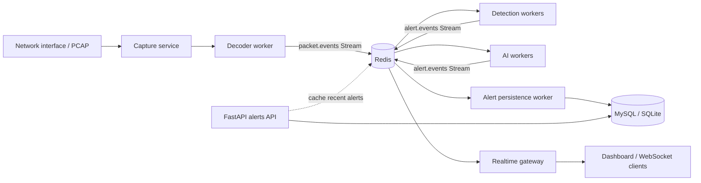

# Kiến trúc tích hợp Redis cho Hybrid NIDS

## 1. Mục tiêu

Redis được bổ sung vào giữa các thành phần xử lý để tách capture khỏi các worker
phân tích và tách việc phát cảnh báo khỏi việc lưu database/API. Mục tiêu là:

- Không để việc ghi database hoặc gửi WebSocket làm chậm packet capture.
- Cho phép tăng số lượng worker decoder/detection độc lập.
- Có hàng đợi bền vững hơn `queue.Queue` trong bộ nhớ của một process.
- Phát cảnh báo gần realtime cho dashboard.
- Có cơ chế retry, backpressure, TTL và giám sát độ trễ.

Redis không thay thế database quan hệ. Database vẫn là nơi lưu trữ lâu dài cho
alert và audit; Redis là lớp vận chuyển, trạng thái ngắn hạn và cache.

## 2. Hiện trạng cần chuyển đổi

Pipeline hiện tại trong [main.py](../main.py) là:

```text
PacketCapture -> PacketDecoder -> queue.Queue -> DetectionEngine
                                            -> AITrafficWorker
                                            -> EventRepository
```

`queue.Queue` chỉ tồn tại trong một process. Nếu process dừng, packet đang chờ
sẽ mất; đồng thời không thể chia tải giữa nhiều instance. Redis sẽ thay thế
phần queue và bổ sung kênh alert realtime.

## 3. Kiến trúc mục tiêu



### 3.1. Trách nhiệm của từng service

| Service | Trách nhiệm | Không nên làm |
|---|---|---|
| Capture | Nhận packet từ live interface hoặc PCAP | Không ghi DB trực tiếp |
| Decoder | Gọi `PacketDecoder.decode()` và chuẩn hóa event | Không chạy rule nặng |
| Detection worker | Chạy `DetectionEngine.evaluate_packet()` | Không phụ thuộc WebSocket |
| AI worker | Phân tích anomaly từ packet/feature | Không làm mất event khi DB chậm |
| Persistence worker | Lưu alert vào database, retry lỗi tạm thời | Không chặn capture |
| Realtime gateway | Đọc alert và phát WebSocket | Không là nguồn dữ liệu lâu dài |
| FastAPI | Query alert đã lưu, cung cấp API | Không query Redis thay cho database lịch sử |

## 4. Chọn Redis Streams và Pub/Sub

### Redis Streams: dữ liệu cần xử lý chắc chắn

Dùng Streams cho packet và alert vì có consumer group, pending entries, ACK và
khả năng đọc lại sau khi worker restart:

```text
nids:packets:v1
nids:alerts:v1
```

Consumer group đề xuất:

```text
nids:packets:v1
  - detection-workers
  - ai-workers

nids:alerts:v1
  - persistence-workers
  - realtime-gateway
```

Lưu ý: mỗi consumer group nhận một bản phân phối riêng. Vì vậy detection và AI
đều nhận được toàn bộ packet, trong khi nhiều instance trong cùng group sẽ chia
nhau xử lý.

### Redis Pub/Sub: tín hiệu không cần replay

Dùng Pub/Sub cho tín hiệu nhẹ, không quan trọng nếu client offline:

```text
nids:system:health
nids:rules:reload
```

Không dùng Pub/Sub làm hàng đợi packet hoặc alert chính vì message sẽ mất khi
subscriber tạm thời không kết nối.

## 5. Contract dữ liệu

### 5.1. Packet event

Event được tạo sau `PacketDecoder.decode()`:

```json
{
  "schema_version": 1,
  "event_id": "uuid",
  "created_at": "2026-10-19T11:00:00.000Z",
  "source": "capture-01",
  "packet": {
    "timestamp": 1792407600.0,
    "src_ip": "192.168.1.100",
    "dst_ip": "10.0.0.5",
    "src_port": 54321,
    "dst_port": 80,
    "protocol": "TCP",
    "tcp_flags": {
      "SYN": false,
      "ACK": true,
      "FIN": false,
      "RST": false,
      "PSH": true,
      "URG": false,
      "raw_flags": "PA"
    },
    "raw_payload_b64": "R0VUIC8uLi4=",
    "http_data": {
      "method": "GET",
      "uri": "/search?q=test",
      "path": "/search",
      "query_params": "q=test",
      "headers": {
        "host": "victim.com"
      },
      "body": ""
    }
  }
}
```

Không đưa `raw_packet` đầy đủ vào Redis ở bản production nếu không cần thiết:
payload lớn làm tăng RAM và network cost. Có thể chỉ giữ metadata + payload giới
hạn kích thước, hoặc lưu packet capture ở object storage và truyền reference.

### 5.2. Alert event

Alert event dùng lại các trường do `_trigger_alert()` tạo:

```json
{
  "schema_version": 1,
  "event_id": "uuid",
  "alert_id": "uuid",
  "created_at": "2026-10-19T11:00:00.100Z",
  "source_type": "rule",
  "sid": 1000001,
  "msg": "SQL injection attempt",
  "severity": "high",
  "classtype": "web-application-attack",
  "src_ip": "192.168.1.100",
  "src_port": 54321,
  "dst_ip": "10.0.0.5",
  "dst_port": 80,
  "protocol": "TCP",
  "http_method": "GET",
  "http_uri": "/search?q=test"
}
```

Mỗi event phải có `event_id` ổn định để persistence worker có thể xử lý
idempotent. Database nên có unique index trên `alert_id` hoặc `event_id`.

## 6. Luồng xử lý và ACK

1. Capture nhận packet.
2. Decoder decode packet; packet không phải IP bị bỏ qua như hiện tại.
3. Decoder `XADD` vào `nids:packets:v1`.
4. Detection và AI đọc bằng `XREADGROUP`.
5. Worker xử lý thành công thì `XACK`.
6. Detection tạo alert và `XADD` vào `nids:alerts:v1`.
7. Persistence worker lưu database thành công rồi `XACK`.
8. Realtime gateway đọc alert, phát WebSocket rồi `XACK`.

Nếu worker chết sau khi đọc nhưng trước khi ACK, message nằm trong Pending
Entries List. Một scheduler phải dùng `XAUTOCLAIM` để lấy lại message quá hạn.
Không ACK trong `finally`; chỉ ACK sau khi thao tác downstream thành công.

## 7. Backpressure, retry và chống mất dữ liệu

### 7.1. Giới hạn stream

Dùng trimming có kiểm soát, ví dụ:

```text
XADD nids:packets:v1 MAXLEN ~ 1000000 * ...
XADD nids:alerts:v1  MAXLEN ~ 100000  * ...
```

Các giá trị trên là điểm bắt đầu, cần điều chỉnh theo tốc độ packet, kích thước
event và thời gian xử lý. Không trim alert trước khi persistence worker xử lý.

### 7.2. Retry

- Lỗi Redis tạm thời: retry exponential backoff có jitter.
- Lỗi database tạm thời: giữ message pending và retry.
- Payload lỗi schema: chuyển sang stream dead-letter, không retry vô hạn.

Stream dead-letter đề xuất:

```text
nids:packets:dlq:v1
nids:alerts:dlq:v1
```

Mỗi message nên có `attempt_count`, `last_error` và `failed_at`.

### 7.3. Khi Redis unavailable

- Capture phải báo lỗi rõ ràng và dừng/giảm tốc có chủ đích, không âm thầm bỏ
  packet.
- Có thể dùng buffer cục bộ giới hạn trong thời gian Redis restart.
- Không dùng fallback vô hạn sang `queue.Queue`, vì điều đó làm mất đảm bảo
  durability và che giấu sự cố.

## 8. Trạng thái ngắn hạn và cache

Redis có thể lưu:

```text
nids:dedupe:{fingerprint}       TTL 60-300s
nids:flow:{src}:{dst}:{ports}   TTL theo flow timeout
nids:cache:alerts:recent        TTL 5-15s
nids:metrics:{service}:{name}   TTL hoặc rolling counter
```

Fingerprint deduplication nên bao gồm `sid`, source/destination, protocol và
bucket thời gian. Không dùng dedupe để thay thế alert persistence; đây chỉ là
throttling chống alert storm.

## 9. Bảo mật và vận hành

- Redis không expose trực tiếp ra Internet; chỉ bind private network.
- Dùng `REDIS_URL` hoặc các biến môi trường tương đương, không hard-code
  password trong [settings.yaml](../config/settings.yaml).
- Bật ACL, tạo user riêng cho capture, worker và API với quyền tối thiểu.
- Bật TLS khi Redis nằm khác host hoặc qua network không tin cậy.
- Tắt các command nguy hiểm nếu môi trường vận hành yêu cầu.
- Theo dõi `used_memory`, `maxmemory`, evicted keys, stream length, pending
  count, oldest pending age và processing latency.
- Đặt `maxmemory-policy` phù hợp. Không dùng eviction tùy tiện cho stream packet
  nếu yêu cầu không mất dữ liệu; cần capacity planning hoặc persistence.

Metrics tối thiểu:

```text
nids_packets_published_total
nids_packets_processed_total
nids_packets_failed_total
nids_alerts_published_total
nids_alerts_persisted_total
nids_stream_pending_messages
nids_oldest_pending_age_seconds
nids_processing_latency_seconds
```

## 10. Triển khai theo giai đoạn

### Giai đoạn 1: nền tảng và contract

- Thêm client Redis và cấu hình qua environment.
- Tạo module dùng chung cho connection pool, serializer và stream names.
- Viết test contract cho packet/alert event.
- Giữ `PacketDecoder` thuần và test được bằng PCAP như hiện tại.

### Giai đoạn 2: packet stream

- Tách capture/decoder thành producer.
- Tạo detection consumer group.
- Thêm ACK, retry, `XAUTOCLAIM` và DLQ.
- Đo throughput và pending count trên PCAP mẫu.

### Giai đoạn 3: AI và persistence

- Tạo AI consumer group độc lập.
- Chuyển `handle_alert()` từ ghi DB đồng bộ sang alert producer.
- Tạo persistence worker với idempotency.

### Giai đoạn 4: realtime/API

- Realtime gateway đọc `nids:alerts:v1` và phát WebSocket.
- API tiếp tục đọc lịch sử từ database.
- Cache endpoint recent alerts với TTL ngắn, có invalidation khi alert mới.

### Giai đoạn 5: production hardening

- Redis Sentinel hoặc Redis Cluster tùy yêu cầu HA và throughput.
- Backup/RDB/AOF theo mục tiêu RPO/RTO.
- Load test, chaos test Redis restart và kiểm tra reclaim pending message.
- Dashboard metrics và cảnh báo khi stream lag vượt ngưỡng.

## 11. Tiêu chí nghiệm thu

- Restart detection worker không làm mất message chưa ACK.
- Database tạm thời unavailable không làm mất alert; alert được retry sau khi DB
  hoạt động lại.
- Realtime client disconnect không làm mất alert trong persistence stream.
- Nhiều worker cùng consumer group chia tải, không xử lý trùng bình thường.
- Event lỗi schema đi vào DLQ và có thể truy vết bằng `event_id`.
- Capture offline PCAP vẫn xử lý hết packet và có thể đo được số packet publish,
  process, alert persist.
- Không có credential Redis trong source control.
