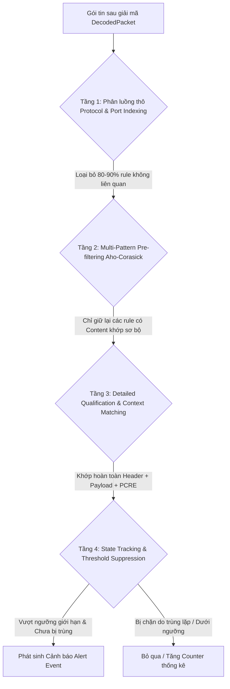
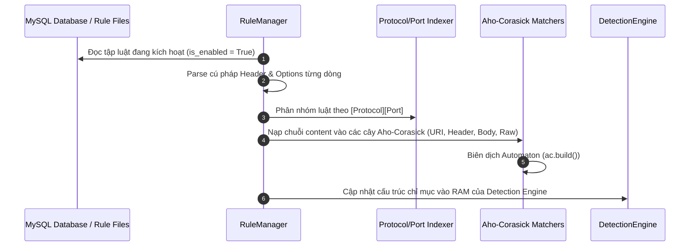
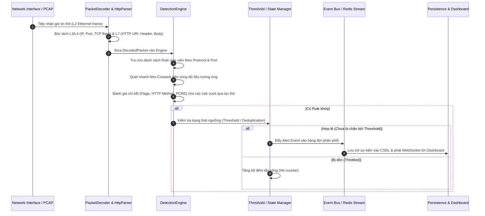

# Kế Hoạch Kiến Trúc & Triển Khai Tập Luật Đa Dạng (Snort Rules) Cho Hybrid NIDS

> **Mục tiêu:** Xây dựng giải pháp kiến trúc, cơ chế phân loại, luồng vận hành và chiến lược tối ưu hóa để áp dụng, kiểm soát và đánh giá mở rộng các loại luật phát hiện xâm nhập (Snort-compatible rules) vào môi trường thực tế của hệ thống Hybrid NIDS.

---

## 1. Hiện Trạng & Thách Thức Khi Đưa Vào Vận Hành Thực Tế

### 1.1. Hiện trạng hệ thống
- Hệ thống hiện tại chỉ nạp một số lượng nhỏ rules mẫu tĩnh (chủ yếu là Web Attacks cơ bản và Network Scan).
- Quá trình so khớp trong [ids_realtime.py](file:///d:/My%20Workspace/%C4%90%E1%BB%93%20%C3%81n/PBL4/App/services/detection/ids_realtime.py) duyệt tuần tự qua danh sách rule (`for rule in rules`), chưa tối ưu hóa phân nhóm theo Protocol/Port ở tầng lọc thô.
- Chưa có cơ chế quản lý ngưỡng phát hiện (`threshold` / `rate-limit`) cho các đợt tấn công lặp lại tần suất cao (DoS, Brute Force).
- Cần mở rộng hỗ trợ đầy đủ các giao thức (TCP, UDP, ICMP, DNS, FTP, SSH, HTTP) và các nhóm hiểm họa thực tế trong mạng doanh nghiệp.

### 1.2. Thách thức kỹ thuật trong sản phẩm thật
1. **Nghẽn hiệu năng (Throughput Bottleneck):** Khi tăng số lượng rule từ hàng chục lên hàng trăm hoặc hàng nghìn rule (như bộ Snort Community / Emerging Threats), việc so khớp trực tiếp trên từng gói tin sẽ làm rớt gói (Packet Drop) nghiêm trọng.
2. **Cảnh báo giả (False Positives) & Bão Alert (Alert Storm):** Một cuộc quét cổng hoặc tấn công từ chối dịch vụ có thể sinh ra hàng triệu sự kiện giống nhau trong vài giây, làm tê liệt Database và giao diện Dashboard.
3. **Tính liên tục khi cập nhật (Zero-downtime Rule Reload):** Người quản trị thêm/sửa/tắt rule qua Dashboard API phải có hiệu lực ngay lập tức trong RAM của Detection Engine mà không cần khởi động lại toàn bộ tiến trình bắt gói tin.

---

## 2. Phân Loại Tập Luật Theo Nhóm Tấn Công Thực Tế (Rule Taxonomy)

Toàn bộ hệ thống luật được cấu trúc thành các domain chuyên biệt, lưu trữ dưới dạng file `.rules` và đồng bộ vào bảng CSDL `rules` để quản lý qua API:

```text
rules/
├── web_attacks.rules         # Tấn công ứng dụng Web (SQLi, XSS, RCE, Path Traversal, SSRF)
├── dos_attacks.rules         # Tấn công từ chối dịch vụ (SYN Flood, UDP Flood, Slowloris, ICMP Flood)
├── network_scans.rules       # Thăm dò & Quét cổng (Nmap Xmas, Null, FIN, SYN Scan, Window Scan)
├── brute_force.rules         # Dò quét mật khẩu (SSH, FTP, HTTP Basic Auth, Admin Form Login)
├── malware_c2.rules          # Mã độc & C2 (Webshell, Reverse Shell, C2 Beaconing, Malicious User-Agent)
├── protocol_anomalies.rules  # Bất thường giao thức (DNS Tunneling, SNMP public community, ICMP exfiltration)
└── policy_violations.rules   # Vi phạm chính sách an toàn (Truyền plaintext password, torrent, mining pool)
```

### Chi tiết các domain và đặc trưng nhận diện:

| Domain Luật | Giao thức mục tiêu | Vùng dữ liệu kiểm tra (Payload Region) | Tiêu chí phân loại |
|---|---|---|---|
| **Web Attacks** | TCP / $HTTP_PORTS | `http_uri`, `http_client_body`, `http_header`, `http_method` | SQL keywords, thẻ script, regex command, directory traversal. |
| **DoS / DDoS** | TCP, UDP, ICMP | Header flags (SYN không ACK), packet rate, raw payload size | Cờ dị thường, tần suất lưu lượng vượt ngưỡng từ một nguồn. |
| **Network Scans** | TCP, ICMP | TCP flags (`FUP`, `0`, `F`, `SF`), ICMP Type/Code | Mẫu bắt tay bất thường được sử dụng bởi các công cụ nmap, masscan. |
| **Brute Force** | TCP (21, 22, 80, 443) | Application handshake & auth payload | Chuỗi định danh phiên ("SSH-2.0", "USER anonymous", HTTP Auth header). |
| **Malware & C2** | TCP, UDP, HTTP | Raw payload, HTTP body, HTTP headers | Các hàm thực thi mã nguy hiểm (`eval`, `base64_decode`, `/bin/sh`), User-Agent nghi vấn. |
| **Protocol Abuse** | UDP (53, 161), ICMP | UDP payload, DNS subdomains, ICMP Echo payload | Chuỗi SNMP "public", tên miền DNS sinh ngẫu nhiên (DGA/Tunneling). |

---

## 3. Giải Pháp Kiến Trúc So Khớp Đa Tầng (Multi-Tier Detection Architecture)

Để đảm bảo hiệu năng cao khi mở rộng số lượng rules, Detection Engine chuyển đổi sang mô hình **Phễu Lọc 4 Tầng (4-Tier Inspection Funnel)**:



### Chi tiết 4 tầng xử lý:

1. **Tầng 1 - Protocol & Port Demux (Phân luồng thô):**
   - **Cách thức:** Thay vì duyệt toàn bộ rules, Engine duy trì một bảng băm chỉ mục (Lookup Table): `index[protocol][destination_port]`.
   - **Tác dụng:** Một gói tin HTTP đến cổng 80 sẽ bỏ qua ngay lập tức toàn bộ rules của DNS, SSH, FTP, ICMP.

2. **Tầng 2 - Multi-Pattern Pre-filtering (Lọc mẫu đa chuỗi Aho-Corasick):**
   - **Cách thức:** Gom toàn bộ các chuỗi tĩnh `content` của các rule vào cây trạng thái Aho-Corasick Automaton theo từng phân vùng (`raw_payload`, `http_uri`, `http_header`, `http_body`).
   - **Tác dụng:** Tìm kiếm đồng thời hàng trăm mẫu chuỗi chỉ trong một lượt duyệt duy nhất $O(L)$ với $L$ là độ dài payload.

3. **Tầng 3 - Detailed Qualification & Context Evaluation (Đánh giá ngữ cảnh chi tiết):**
   - **Cách thức:** Chỉ những rule đã vượt qua Tầng 2 mới được chuyển tiếp vào Tầng 3 để kiểm tra logic phức tạp:
     - So khớp TCP Flags (`flags:S`, `flags:FUP`, `flags:0`).
     - So khớp phương thức HTTP (`http_method: POST`).
     - So khớp biểu thức chính quy (`pcre`).
   - **Tác dụng:** Tránh việc chạy Regex (`pcre`) vốn rất tốn CPU trên mọi gói tin.

4. **Tầng 4 - State Tracking & Threshold Suppression (Chống bão cảnh báo):**
   - **Cách thức:** Áp dụng cơ chế Throttling theo `sid` và cặp IP nguồn/đích.
   - **Quy tắc:**
     - `threshold: type limit, track by_src, count 1, seconds 60`: Trong vòng 60 giây, chỉ bắn tối đa 1 cảnh báo từ cùng một IP nguồn cho cùng một SID.
     - Các lần vi phạm tiếp theo trong cửa sổ thời gian chỉ làm tăng số đếm tổng (Aggregated Hit Counter), không sinh bản ghi cảnh báo mới.

---

## 4. Luồng Hoạt Động Của Hệ Thống (End-to-End Operational Workflows)

### 4.1. Luồng nạp và đánh chỉ mục luật (Rule Indexing & Loading)



### 4.2. Luồng xử lý và phát hiện gói tin thời gian thực (Packet Processing Pipeline)



### 4.3. Luồng Hot-Reload luật khi quản trị viên thay đổi cấu hình

Khi quản trị viên thực hiện CRUD hoặc Bật/Tắt (Toggle) rule qua Dashboard API:
1. API ghi nhận thay đổi vào CSDL và phát một tín hiệu thông báo (Reload Event).
2. `RuleManager` đọc lại tập luật đang kích hoạt từ CSDL vào một bộ đệm tạm (Shadow Index).
3. Biên dịch lại các cây Aho-Corasick trên Shadow Index.
4. Tráo đổi con trỏ (Atomic Pointer Swap) sang Shadow Index mới.
5. **Kết quả:** Tiến trình phát hiện không bị gián đoạn, không làm mất gói tin đang xử lý.

---

## 5. Chiến Lược Kiểm Thử & Đánh Giá Chất Lượng Trong Môi Trường Thật

Để đảm bảo các loại rule hoạt động chính xác trước và trong khi đưa vào môi trường thực tế, hệ thống áp dụng chiến lược kiểm thử 3 lớp:

```mermaid
graph LR
    L1[Lớp 1: Khảo sát cú pháp & Tính toàn vẹn]<br/>Parse Validation --> L2[Lớp 2: Kiểm thử độ chính xác & Né tránh]<br/>Attack Verification & Evasion --> L3[Lớp 3: Kiểm thử tải & Throughput]<br/>Stress & Traffic Replay
```

### 5.1. Lớp 1: Kiểm thử cú pháp & Độ tương thích (Syntax & Schema Verification)
- Tự động kiểm tra tính hợp lệ của toàn bộ file `.rules`:
  - Kiểm tra Header: `action`, `proto`, địa chỉ IP/CIDR, port hoặc biến danh sách (`$HTTP_PORTS`).
  - Kiểm tra Options: Đảm bảo không trùng lặp `sid`, có đầy đủ `msg`, `rev`, `severity`, `classtype`.
  - Kiểm tra tính hợp lệ của biểu thức regex trong `pcre` (tránh lỗi Catastrophic Backtracking gây treo Engine).

### 5.2. Lớp 2: Kiểm thử độ nhạy & Phòng chống né tránh (Precision, Recall & Evasion)
- **Tập dữ liệu kiểm thử (Attack Corpus):** Xây dựng kho lưu trữ các gói tin tấn công mẫu cho từng loại hình vi:
  - Tấn công Web: Kỹ thuật phân mảnh URL, thay đổi hoa thường (`nocase`), ký tự mã hóa URL (`%20`, `%27`), HTTP header giả mạo.
  - Quét mạng: Các tổ hợp cờ TCP bất thường (Xmas `FUP`, Null, FIN, SYN-FIN).
  - Tấn công xác thực: Dò quét SSH/FTP và đăng nhập brute-force form POST.
  - Tấn công DoS: Lưu lượng TCP SYN tốc độ cao và cạn kiệt kết nối Slowloris.
- **Tiêu chí đánh giá:**
  - **Tỷ lệ phát hiện (True Positive Rate):** Đạt 100% đối với các mẫu tấn công định danh chuẩn.
  - **Tỷ lệ báo động giả (False Positive Rate):** Lưu lượng người dùng bình thường (Normal HTTP browsing, ICMP ping, DNS thông thường) phải có kết quả nhận diện = 0 cảnh báo.

### 5.3. Lớp 3: Kiểm thử tải cao & Tái phát lưu lượng (Stress & Replay Testing)
- Sử dụng các công cụ phát lại lưu lượng mạng (`tcpreplay` hoặc PCAP replayer) phát lại hàng triệu gói tin ở các mức băng thông (10 Mbps, 100 Mbps, 1 Gbps).
- Đo lường các chỉ số vận hành quan trọng:
  - **Tốc độ xử lý gói tin (Packets Per Second - PPS):** Đảm bảo không bị suy giảm khi nạp thêm các tập luật phức tạp.
  - **Độ trễ xử lý (Latency per packet):** Thời gian trung bình từ khi nhận gói tin đến khi hoàn tất so khớp phải duy trì ở mức sub-millisecond (< 1ms).
  - **Tỷ lệ rớt gói (Packet Drop Rate):** Bằng 0 khi vận hành ở ngưỡng tải thiết kế.

---

## 6. Lộ Trình Triển Khai Vào Dự Án Thật (Production Rollout Roadmap)

| Giai đoạn | Trọng tâm công việc | Kết quả bàn giao (Deliverables) |
|---|---|---|
| **Giai đoạn 1: Chuẩn hóa & Mở rộng Rule Base** | • Bổ sung các file rule chuyên biệt vào thư mục `rules/` (`dos_attacks.rules`, `brute_force.rules`, `malware_c2.rules`, `udp_icmp.rules`).<br>• Đồng bộ toàn bộ tập luật chuẩn vào bảng `rules` trong CSDL MySQL. | Kho luật chuẩn hóa tương thích Snort, phân tách rõ ràng theo từng loại tấn công. |
| **Giai đoạn 2: Tối ưu hóa Bộ máy So khớp (Engine Optimization)** | • Cải tiến [ids_realtime.py](file:///d:/My%20Workspace/%C4%90%E1%BB%93%20%C3%81n/PBL4/App/services/detection/ids_realtime.py): Thiết lập bảng băm chỉ mục Protocol/Port.<br>• Phân bổ mẫu chuỗi vào các cây Aho-Corasick tương ứng với từng vùng HTTP/Raw. | Engine xử lý theo phễu lọc đa tầng, giảm tải CPU khi nạp nhiều rules. |
| **Giai đoạn 3: Kiểm soát Ngưỡng & Chống bão cảnh báo (Thresholding)** | • Tích hợp cơ chế kiểm soát tần suất cảnh báo theo cửa sổ thời gian (in-memory sliding window hoặc Redis key TTL).<br>• Tự động gom nhóm các sự kiện trùng lặp. | Hệ thống không bị treo hoặc tràn CSDL khi gặp tấn công từ chối dịch vụ hoặc quét mạng. |
| **Giai đoạn 4: Quản lý & Hot-reload qua Dashboard API** | • Hoàn thiện các API CRUD rule và toggle trạng thái bật/tắt trong [rules.py](file:///d:/My%20Workspace/%C4%90%E1%BB%93%20%C3%81n/PBL4/App/api/routes/rules.py).<br>• Triển khai cơ chế tráo đổi con trỏ bộ nhớ (Atomic Hot-reload) trong `RuleManager`. | Quản trị viên cập nhật luật tức thời từ giao diện người dùng mà không cần gián đoạn giám sát mạng. |
| **Giai đoạn 5: Đánh giá & Giám sát Vận hành** | • Đo lường hiệu năng thực tế trên card mạng thật (Live sniff) và file PCAP lớn.<br>• Tinh chỉnh loại bỏ các rule gây báo động giả (False Positives). | Báo cáo đánh giá hiệu năng và bộ luật hoàn thiện đạt chuẩn vận hành ổn định. |
