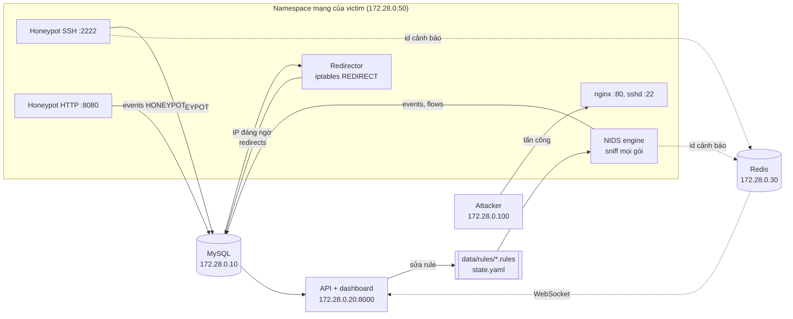
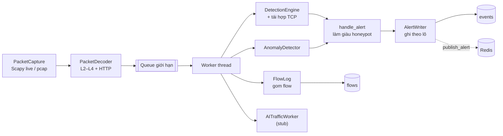

# Kiến trúc hệ thống

## 1. Tổng quan

Hệ thống gồm nhiều process chạy độc lập. Các process chỉ giao tiếp qua **cơ sở dữ liệu chung** và các **file trong `data/rules/`**. Ngoại lệ duy nhất là tín hiệu "có cảnh báo mới" qua Redis. Tín hiệu này chỉ mang id, dữ liệu vẫn đọc từ DB.



| Process | Lệnh | Đọc | Ghi |
|---|---|---|---|
| Engine | `python -m nids.engine` | gói mạng, `data/rules/`, IP honeypot trong `events` | `events`, `flows`, Redis |
| Honeypot SSH / HTTP | `python -m nids.honeypot ssh\|http` | kết nối của attacker | `events` (`HONEYPOT`), Redis |
| Redirector | `python -m nids.redirector` | `events` (IP có nhiều cảnh báo) | `redirects`, iptables |
| API + dashboard | `uvicorn nids.api.main:app` | toàn bộ DB, Redis | xoá `events`, file `data/rules/` |

Vì không process nào gọi trực tiếp process khác, khởi động lại dashboard không ảnh hưởng việc phát hiện. Một honeypot chết cũng không làm dừng engine.

## 2. Luồng xử lý trong engine



- **Thread capture** decode gói rồi đưa vào queue. Ở chế độ live, queue đầy thì bỏ gói và đếm. Ở chế độ offline thì chờ, không bỏ gói nào.
- **Một worker thread duy nhất** chạy lần lượt rule, tái hợp TCP, gom flow và phát hiện bất thường. Vì chỉ có một thread nên bảng flow và bảng đếm không cần khoá.
- **Thread `alert-writer`** gom tối đa 200 cảnh báo hoặc 1 giây rồi ghi một lần. Sau khi commit thì đẩy id lên Redis.
- Lỗi ghi DB chỉ được log và bỏ lô đó. Engine không bao giờ dừng vì lỗi CSDL.

Chi tiết từng bước: [detection-engine.md](detection-engine.md).

## 3. Cơ sở dữ liệu

DB chỉ lưu **dữ liệu quan sát được** và **nhật ký hành động** của hệ thống. Rule không nằm trong DB.

| Bảng | Nội dung | Ghi bởi |
|---|---|---|
| `events` | Một dòng cho mỗi cảnh báo hoặc sự kiện honeypot: thời gian, `source_type`, `sid`, `severity`, `attack_type`, IP/cổng, HTTP method/URI, `summary`, `session_id` | engine, honeypot |
| `event_payloads` | Bằng chứng đi kèm một event (quan hệ 1–1): `matched_content`, `http_headers`, `http_body` | engine, honeypot |
| `flows` | Một dòng cho mỗi flow đã kết thúc: 5-tuple, số gói và byte hai chiều, cờ TCP, `end_reason`, `alert_count` | engine |
| `redirects` | Lịch sử chuyển hướng IP: `ip`, `created_at`, `expires_at`, `removed_at` (NULL là đang hiệu lực), `reason` | redirector |

`source_type` phân biệt nguồn của event:

| Giá trị | Nguồn |
|---|---|
| `RULE_ENGINE` | Rule Snort khớp |
| `ANOMALY` | Phát hiện bất thường theo ngưỡng (`sid` NULL) |
| `HONEYPOT` | Honeypot SSH hoặc HTTP |
| `AI_ENGINE` | Dành cho mô hình AI, chưa dùng |

Quy ước:

- Mọi cột thời gian lưu **UTC naive**.
- Repo không có migration: `create_all` tạo bảng còn thiếu, còn `_add_missing_columns()` thêm cột và index mới cho bảng `events`.
- `init_db()` thử kết nối 15 lần, mỗi lần cách 2 giây, vì MySQL khởi động chậm.

## 4. Redis và cảnh báo realtime

```
AlertWriter commit ──► publish_alert(id) ──► Redis channel "nids:alerts"
                                                   │
Dashboard ◄── WebSocket /api/alerts/ws ◄── API subscribe
   │
   └── nhận id ──► gọi lại REST để lấy dữ liệu
```

- Tin nhắn chỉ chứa **id** của cảnh báo, nên không thể sinh vòng lặp cảnh báo. Dữ liệu vẫn đọc từ DB.
- `publish_alert` chạy ở thread nền và chỉ log khi lỗi, nên không bao giờ chặn sensor.
- Redis tắt hoặc chết thì WebSocket đóng với mã 1013. Dashboard tự chuyển sang poll mỗi 2 giây và kết nối lại khi Redis sống lại.

## 5. Mạng Docker

Mạng bridge cô lập `nids_isolated_net` (`172.28.0.0/16`):

| Container | Địa chỉ | Ghi chú |
|---|---|---|
| `mysql_db` | `172.28.0.10` | DB chung, volume ẩn danh |
| `nids_api` | `172.28.0.20`, cổng `8000` ra host | Mạng riêng để engine không sniff request của dashboard |
| `redis` | `172.28.0.30` | Có mật khẩu, không lưu bền, không publish cổng |
| `victim_app` | `172.28.0.50` | nginx và các dịch vụ làm mục tiêu |
| `nids_engine`, `honeypot_ssh`, `honeypot_http`, `nids_redirector` | dùng namespace của `victim_app` | Engine thấy mọi gói tới victim và honeypot |
| `attacker` | `172.28.0.100` | Kali Linux: nmap, hping3, hydra, sqlmap, nikto. Chỉ chạy khi bật profile `lab` |

**BPF filter phải loại kết nối của chính hệ thống:** `ip and not port 3306 and not (host 172.28.0.30 and port 6379)`.

- Nếu không loại cổng 3306, engine sniff câu `INSERT` chứa chuỗi tấn công của chính nó và sinh cảnh báo mới thành vòng lặp.
- Redis chỉ loại đúng địa chỉ của lab, không loại cả cổng 6379, để vẫn thấy đòn nhắm vào cổng 6379 của victim.

## 6. Cấu hình

`common/config/settings.yaml` là file local, bị gitignore. Thiếu file này thì chương trình dùng `common/config/settings.example.yaml`, vốn cấu hình sẵn cho Docker lab. Biến môi trường ghi đè YAML.

| Mục | Nội dung |
|---|---|
| `system` | `log_level` |
| `network` | `interface`, `bpf_filter`, `capture_mode` (`live`/`offline`), `pcap_file` |
| `detection` | `rules_dir`, `queue_max_size`, `variables` (`$HOME_NET`, `$HTTP_PORTS`...) |
| `stream` | Tái hợp TCP: `enabled`, giới hạn bộ nhớ |
| `flow` | Timeout flow, `retention_hours` |
| `anomaly` | Ngưỡng scan, flood, `common_ports`, `suppress_seconds` |
| `database` | `type` (`mysql`/`sqlite`), kết nối; biến `NIDS_DB_*` |
| `redis` | `host` rỗng là tắt; biến `NIDS_REDIS_*` |
| `redirect` | Ngưỡng chuyển hướng, TTL, cổng, allowlist |
| `api` | Cấu hình API |

Đổi `detection.variables` thì phải khởi động lại **cả engine lẫn API**, vì API dùng các biến này để kiểm tra `custom.rules`.

## 7. Đóng gói

Mỗi service là một thư mục trong `services/` với mã nguồn, test, Dockerfile và file phụ thuộc riêng. Phần dùng chung nằm trong `common/core` (không import từ service nào).

| Image | Thư viện nặng được cài | Ghi chú |
|---|---|---|
| `nids-sensor` | scapy, pyahocorasick, numpy, scikit-learn, joblib | Cần libpcap; chạy với `NET_ADMIN`, `NET_RAW` |
| `nids-honeypot` | paramiko, flask, waitress | Một image, hai container (`ssh`, `http`) |
| `nids-redirector` | không | Cài `iptables`; chạy với `NET_ADMIN` |
| `nids-dashboard` | fastapi, uvicorn, websockets | Chứa cả mã nguồn sensor để kiểm tra `custom.rules`, nhưng không cài scapy |

- Rule, mô hình và cấu hình **không** nằm trong image: compose gắn `data/rules` (sensor chỉ đọc, dashboard được ghi), `data/models` (sensor) và `common/config` (mọi service) lúc chạy. Nhờ đó dashboard sửa rule thì sensor thấy ngay và tự nạp lại.
- Build từ gốc repo: `docker build -f services/<tên>/Dockerfile .`. Compose chỉ đặt khối `build` cho sensor và một honeypot, các service còn lại dùng lại image đó, vì build nhiều image song song dễ làm Docker Desktop sập.
- Mã nguồn dùng chung họ tên module `nids.*` (namespace package). Image đặt `PYTHONPATH` trỏ đúng các thư mục `src` của nó; trên máy phát triển dùng `scripts/env.ps1` hoặc `scripts/env.sh`.

